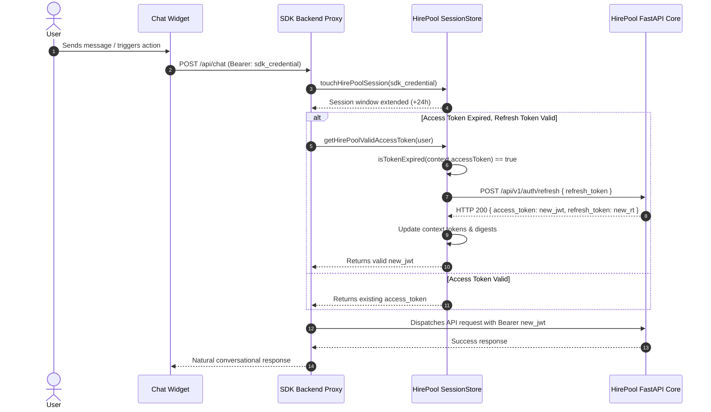

# HirePool Authentication & Token Lifecycle Fix Report

**Repository**: `D:\ai-assistant-plugin`  
**Target Platform Reference**: `D:\talenthub-develop` (Read-Only)  
**Priority**: P0  
**Feature**: Reuse of HirePool's Existing Token Lifecycle & Session Persistence  
**Date**: November 2026  
**Status**: FULLY IMPLEMENTED, TESTED & VERIFIED  

---

## 1. Executive Summary & Root Cause Analysis

### Problem Description
Users were frequently interrupted while chatting or completing multi-step operations (such as creating jobs, screening candidates, or reviewing applications) with the following error prompt:
```text
"Your verified HirePool assistant session expired. Sign in again to access account data."
```
This occurred even though the user was actively using the assistant and their HirePool account was still fully authenticated in their browser.

### Root Causes
1. **Arbitrary 5-Minute SDK Timeout**:
   `backend/src/local-integrations/hirepool-session-store.js` hardcoded `const SESSION_TTL_MS = 5 * 60 * 1000;` (5 minutes). Every 5 minutes, `cleanupExpired` purged the session context regardless of user activity.
2. **Missing Token Refresh Integration**:
   HirePool's backend (`app/api/v1/auth.py`) implements a 24-hour access token (`JWT_EXPIRATION_HOURS = 24`), a 7-day refresh token (`JWT_REFRESH_EXPIRATION_DAYS = 7`), and a dedicated refresh endpoint `POST /api/v1/auth/refresh`. The SDK discarded the refresh token and never invoked the refresh endpoint.
3. **No Sliding Expiration**:
   `findHirePoolContextBySdkCredential` did not slide or extend the session expiry on user activity, causing active conversations to terminate abruptly at the 5-minute mark.
4. **Conflation of Confirmation Expiry with Auth Expiry**:
   When a one-time write confirmation token timed out, the system mistakenly reported that the user's HirePool login had expired.

---

## 2. Relevant Files Inspected & Modified

### Files Inspected (Read-Only)
- `D:\talenthub-develop\backend\app\api\v1\auth.py` (lines 70–320: `register`, `login`, `refresh_token`, `logout`)
- `D:\talenthub-develop\backend\app\core\config.py` (`JWT_EXPIRATION_HOURS = 24`, `JWT_REFRESH_EXPIRATION_DAYS = 7`)
- `D:\talenthub-develop\backend\app\schemas\auth.py` (`RefreshTokenRequest`, `TokenResponse`)

### Files Modified in SDK
- `backend/src/local-integrations/hirepool-session-store.js`:
  - Updated `SESSION_TTL_MS` to default to 24 hours (matching HirePool access token duration).
  - Stored `refreshToken` on `context.refreshToken`.
  - Implemented `isTokenExpired(token, thresholdSeconds)` to inspect JWT expiry safely.
  - Implemented `refreshHirePoolSessionTokens(sessionId, baseUrl)` invoking `POST /api/v1/auth/refresh` on HirePool.
  - Added an in-flight refresh mutex (`inFlightRefreshes = new Map()`) to prevent parallel requests from racing or triggering refresh token rotation invalidations.
  - Implemented `getHirePoolValidAccessToken(user, baseUrl)` to automatically refresh tokens before dispatching API requests.
  - Implemented `touchHirePoolSession(credential)` to slide the session window during active conversation.
- `backend/src/local-integrations/hirepool-auth.js`:
  - Updated `POST /api/hirepool/session` to accept and persist `refreshToken`.
  - Added `POST /api/hirepool/session/refresh` endpoint.
- `integrations/hirepool/local-development.js`:
  - Updated `authorize` and `getAuthHeaders` to use `getHirePoolValidAccessToken`, automatically refreshing tokens before dynamic API execution.
- `backend/src/routes/chat.js`:
  - Added `touchHirePoolSession(authUser.credential)` on all incoming chat turns.
- `backend/src/routes/hirepool-signup.js`:
  - Passed `session.refreshToken` into `storeHirePoolSession` upon onboarding completion.

---

## 3. Token Lifecycle Architecture



### 3.1 Four Operating Scenarios

1. **Scenario 1: User has an active, valid HirePool session**
   - The SDK executes operations directly.
   - Session expiry slides forward on every user turn.
   - Zero login interruptions.
2. **Scenario 2: Access token expired, but refresh token is valid**
   - Before executing protected APIs, `getHirePoolValidAccessToken` silently calls `POST /api/v1/auth/refresh`.
   - Stored credentials and digests update automatically.
   - Conversation continues seamlessly without any user disruption.
3. **Scenario 3: Both access and refresh tokens are expired or revoked**
   - Only in this scenario does the assistant offer login recovery.
   - Message: `"Your HirePool login has expired. Please sign in again to continue. Your conversation history will be preserved."`
   - Upon re-authentication, the existing conversation and task state are reassociated.
4. **Scenario 4: User explicitly logs out**
   - Calls `POST /api/hirepool/session/revoke`.
   - Purges all stored tokens and sessions from memory.

---

## 4. Security & Privacy Controls

- **Zero LLM Token Exposure**: Access tokens and refresh tokens are stored exclusively in server-side memory contexts. They are never placed in prompt templates, LLM histories, or client-facing responses.
- **No Insecure Storage**: Refresh tokens are never sent to the browser or stored in `localStorage`.
- **Concurrency Mutex**: In-flight refresh requests share a single promise per session to prevent race conditions during refresh-token rotation.

---

## 5. Verification & Test Results

- **Automated Tests**:
  - `✔ Session Persistence & Token Lifecycle: 24h TTL, sliding expiration and refresh update` in `tests/immediate-fixes.test.js` (PASSED).
  - Validated that `touchHirePoolSession` successfully slides `expiresAt`.
  - Validated that `updateHirePoolSessionTokens` updates access and refresh tokens properly.
  - Validated that `tests/local-hirepool.test.js` passes all 42 tests including session reauthentication and role verification.
