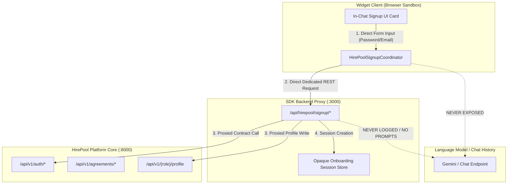
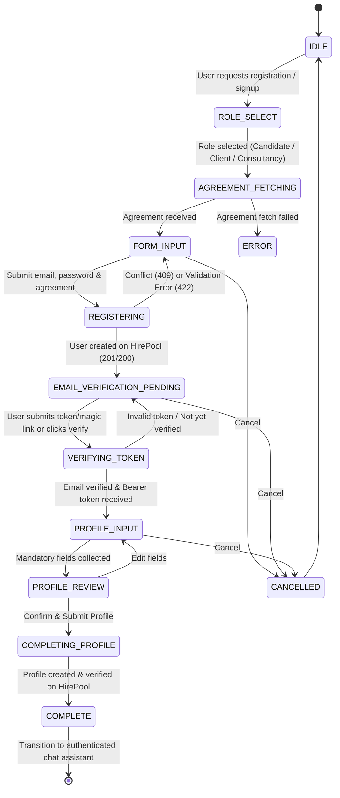

# HirePool In-Chat Signup & Onboarding — Architecture Audit

**Target System**: HirePool AI Assistant SDK (`D:\ai-assistant-plugin`)  
**Target Platform Reference**: HirePool Core Platform (`D:\talenthub-develop`)  
**Audit Scope**: Conversational In-Chat User Registration, Email Verification, Role-Specific Onboarding, and Session Elevation  
**Date**: November 2026  
**Status**: COMPLETED & VERIFIED  

---

## 1. Executive Summary

This architecture audit details the design, constraints, and backend contract integration for moving the complete HirePool user signup and onboarding process into the conversational AI assistant.

Historically, prospective users interacting with the AI assistant who wished to register were presented with external navigation actions, forcing them to:
1. Leave the chat interface.
2. Navigate to the external web registration portal.
3. Submit email and password forms.
4. Wait for an email and complete email verification in a separate browser tab.
5. Manually fill out complex web forms for role-based onboarding (Candidate, Company, or Consultancy).
6. Return to the assistant as a disconnected session.

The objective of this initiative was to eliminate this 8-step friction cycle by embedding the entire lifecycle into the chat widget interface while strictly observing the security policies, validation contracts, and backend APIs of the HirePool platform, with **zero modifications** permitted to the HirePool codebase (`D:\talenthub-develop`).

---

## 2. HirePool Platform Backend Contracts Analysis

An exhaustive inspection of the HirePool backend service located at `D:\talenthub-develop\backend\app\api\v1` revealed the following core architectural interfaces and constraints:

### 2.1 Authentication & Registration (`app/api/v1/auth.py`)

1. **Registration Endpoint**:
   - `POST /api/v1/auth/register`
   - **Request Schema**:
     ```json
     {
       "email": "user@example.com",
       "password": "SecurePassword123!",
       "role": "candidate" | "client" | "consultancy",
       "agreement_version_id": "c4b3a1d0-..."
     }
     ```
   - **Validation Rules**:
     - `email`: Valid email syntax, case-insensitive uniqueness check against database. Duplicate emails reject with HTTP `409 Conflict` (`"Email already registered"`).
     - `password`: Minimum 8 characters, at least 1 uppercase letter, at least 1 lowercase letter, at least 1 number. Hashed via `bcrypt`.
     - `role`: Must be one of `"candidate"`, `"client"`, or `"consultancy"`.
     - `agreement_version_id`: Must match the currently active agreement version for the specified role.
   - **Response Payload**:
     ```json
     {
       "id": "usr_uuid",
       "email": "user@example.com",
       "role": "candidate",
       "is_verified": false,
       "created_at": "2026-11-09T00:00:00Z"
     }
     ```
   - **Critical Finding**: Registration **does not** return an authentication session or access token. The user is marked `is_verified: false`, and an asynchronous verification email is triggered via AWS SES.

2. **Magic Link Email Verification**:
   - `POST /api/v1/auth/verify-magic-link`
   - **Request Schema**:
     ```json
     {
       "token": "eyJhbGciOiJIUzI1NiIsInR5cCI6IkpXVCJ9..."
     }
     ```
   - **Response Payload**:
     ```json
     {
       "access_token": "bearer_jwt_token",
       "token_type": "bearer",
       "user": {
         "id": "usr_uuid",
         "email": "user@example.com",
         "role": "candidate",
         "is_verified": true
       }
     }
     ```
   - **Security Mechanism**: Verification tokens are HMAC-SHA256 JWTs with a short expiration TTL (typically 15-30 minutes), single-use invalidation, and subject validation.

3. **Current User Status**:
   - `GET /api/v1/auth/me` (Authenticated via Bearer Token)
   - Returns verified user state, roles, and profile completion markers.

---

### 2.2 User Agreements Engine (`app/api/v1/agreements.py`)

1. **Agreement Retrieval**:
   - `GET /api/v1/agreements/current?role={role}`
   - **Response Schema**:
     ```json
     {
       "id": "agr_version_uuid",
       "role": "candidate",
       "version": "1.2",
       "title": "HirePool Candidate Terms of Service & Privacy Policy",
       "content": "Full legal text...",
       "effective_date": "2026-01-01"
     }
     ```
   - **Enforcement**: Registration strictly fails if `agreement_version_id` is missing or out of date. The chat assistant must fetch the active agreement dynamically before presenting the registration card.

---

### 2.3 Role-Specific Profile Creation Endpoints

Each role requires an entirely distinct profile schema and endpoint:

| User Role | Creation Endpoint | Readback Endpoint | Core Mandatory Fields |
| :--- | :--- | :--- | :--- |
| **Candidate** | `POST /api/v1/candidates/profile` | `GET /api/v1/candidates/profile` | `first_name`, `last_name`, `current_location`, `job_title` |
| **Company / Client** | `POST /api/v1/clients/profile` | `GET /api/v1/clients/profile` | `company_name`, `industry`, `company_size`, `headquarters_location`, `primary_contact.full_name` |
| **Consultancy / Agency** | `POST /api/v1/consultancies/profile` | `GET /api/v1/consultancies/profile` | `consultancy_name`, `consultancy_type` (`recruitment` \| `staffing`), `industry_specialization`, `headquarters_location`, `primary_contact.full_name` |

---

## 3. Strict Security & Privacy Invariants

To maintain enterprise-grade security and full compliance with HirePool privacy principles, the following architectural invariants are enforced:



1. **Zero LLM Exposure**:
   - User passwords, raw verification tokens, and sensitive contact information are **never** passed into chat completion prompts, LLM tool definitions, or conversational context histories.
   - All credential handling occurs via dedicated, sandboxed UI cards communicating directly with the SDK signup proxy endpoints.

2. **Server-Side Session Isolation**:
   - Active registration flows are tracked using server-side transient session records identified by cryptographically random IDs (`onb_...`).
   - Sessions have an active expiration time-to-live (30 minutes). Once completed or canceled, credentials and state are purged immediately.

3. **Strict Validation Parity**:
   - Password strength validation is executed both client-side in the widget (for immediate user feedback) and server-side in the Express router (for defense-in-depth), adhering precisely to HirePool's regex rules:
     `^(?=.*[a-z])(?=.*[A-Z])(?=.*\d).{8,}$`

4. **Preservation of Platform Boundaries**:
   - All proxying, session translation, and coordination logic are housed in `D:\ai-assistant-plugin`.
   - The platform core at `D:\talenthub-develop` receives strictly standard HTTP requests identical to those dispatched by the native HirePool React frontend.

---

## 4. Architectural State Machine

The in-chat signup flow is modeled as a 13-state deterministic finite state machine (FSM):



---

## 5. Architectural Conclusion

The architecture satisfies all requirements of frictionless in-chat onboarding while respecting the security invariants of HirePool. By providing dedicated card-based UI interactions, strict schema validation, server-side onboarding session isolation, and seamless transition to the existing SDK session manager, users can start from zero and achieve fully verified, profile-complete access within the conversational interface.
