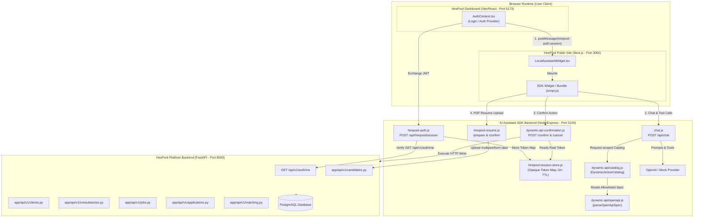

# HirePool × AI Assistant SDK — Comprehensive Technical Architecture & Implementation Audit
**Repository A (HirePool Platform):** `D:\talenthub-develop`  
**Repository B (AI Assistant SDK):** `D:\ai-assistant-plugin`  
**Audit Date:** November 9, 2026  
**Audit Classification:** Strictly Read-Only Repository-Wide Technical Audit & Evidence Matrix  

---

## 1. Executive Summary

This document establishes the definitive, evidence-based technical baseline for the HirePool recruitment platform and its integration with the standalone AI Assistant SDK. Every finding, flow, schema limitation, and capability rating in this report is grounded directly in verified source code, API routes, middleware, and automated test fixtures across both repositories.

### Primary Audit Findings at a Glance

1. **Architecture Decoupling & Token Exchange**: The SDK (`D:\ai-assistant-plugin`) is fully decoupled from HirePool's core codebase (`D:\talenthub-develop`). Integration occurs via a standalone chat widget embedded in HirePool's public Next.js website (`LocalAssistantWidget.tsx`), which communicates with the SDK Express backend (`localhost:3100`) and exchanges user credentials through a secure popup postMessage protocol (`localhost:5173` dashboard).
2. **Dynamic API & OpenAPI Parser Constraint**: Dynamic tool generation operates by parsing the HirePool FastAPI OpenAPI 3.1 specification (`hirepool-openapi.json`). However, the SDK's OpenAPI parser (`backend/src/dynamic-api/openapi.js:377-380`) strictly permits only `GET`, `POST`, and `PUT` HTTP methods. Any endpoint requiring `PATCH` or `DELETE` is hard-rejected during OpenAPI discovery.
3. **Role Asymmetry & Staging Maturity**:
   - **Candidate Role (Mature & Verified)**: Candidate workflows (profile reading/updating, active job search, match score retrieval, screening check, preflight readiness validation, application submission staging, destructive withdrawal, and PDF resume upload) have complete end-to-end multi-turn staging, preflight verification, and 42 passing automated tests (`tests/local-hirepool.test.js`).
   - **Company / Client Role (Connected but Unverified)**: 13 operations are allowlisted. Basic company profile updates have readback verification. Job creation (`create_job`), job update (`update_job`), and bulk status update (`bulk_update_status`) stage review confirmation cards, but lack preflight ownership validation and post-write readback. Single application status updating (`PATCH /api/v1/applications/{application_id}/status`) is rejected by the OpenAPI parser. Candidate detail viewing (`GET /api/v1/clients/candidates/{candidate_id}`) exists in the backend but was omitted from the client role allowlist.
   - **Consultancy / Agency Role (Connected but Severely Gapped)**: 13 operations are allowlisted. Profile updates have readback. Candidate creation (`add_candidate`), candidate update (`update_candidate`), and bulk submission (`bulk_submit_consultancy_candidates`) stage review confirmation cards, but do not pre-check duplicate candidate records or pre-verify candidate ownership/job activity. Candidate detail viewing (`GET /api/v1/consultancies/candidates/{candidate_id}`) and job discovery (`GET /api/v1/jobs/search`) exist in the FastAPI backend but were omitted from the consultancy role allowlist.
4. **Testing Reality**: Test coverage in `tests/local-hirepool.test.js` (42/42 tests passing) executes exclusively against mock HTTP servers simulating FastAPI responses. Zero tests execute against a running FastAPI backend, PostgreSQL database, or headless browser.

---

## 2. System Architecture & Component Mapping



---

## 3. Detailed Request Lifecycle & Integration Flow (24 Stages)

The full interaction cycle between HirePool and the AI Assistant SDK spans 24 discrete operational phases:

1. **Website Loading**: User navigates to `http://localhost:3000` (HirePool public marketing site). `LocalAssistantWidget.tsx` checks `PUBLIC_SITE_PATHS` (`/`, `/features`, `/pricing`, etc.) and determines the local SDK base URL (`http://localhost:3100`).
2. **Widget Script Mount**: `LocalAssistantWidget.tsx` injects `<script src="http://localhost:3100/widget/bundle.js">` with ID `hirepool-local-assistant-sdk`.
3. **SDK Initialization**: The widget script executes `window.AssistantSDK.init(...)`, initializing the floating trigger launcher, chat container, and event bus (`widget/src/widget.js:52`).
4. **Chat Open**: User clicks the launcher button. Widget renders initial guest greeting (`"Welcome to HirePool. Log in or sign up for account-specific job and application help."`) and prompt chips (`"Log in to HirePool"`, `"Sign up for HirePool"`).
5. **Authentication Trigger**: User clicks login or sends an intent requiring authentication. The widget invokes `openHirePoolLoginWindow()` (`widget/src/hirepool-login.js:46`), opening a popup window to `http://localhost:5173/login?assistant_origin=http://localhost:3000`.
6. **HirePool Login**: User completes login in the React dashboard. `AuthProvider` in `frontend/src/contexts/AuthContext.tsx:185` retrieves user identity and JWT access token.
7. **Session Token Exchange**: `AuthContext.tsx:103` sends `POST http://localhost:3100/api/hirepool/session` with `Authorization: Bearer <HirePool JWT>`.
8. **Identity Verification & Session Generation**: `backend/src/local-integrations/hirepool-auth.js:106` calls HirePool's `GET http://localhost:8000/api/v1/auth/me` to validate the JWT. Upon receiving 200 OK, it generates a 32-byte cryptographic base64url credential (`hirepool-session-store.js:35`) mapped to the real JWT with a 300-second (5-minute) TTL.
9. **Popup Handoff**: `AuthContext.tsx:162` sends `window.opener.postMessage({ type: 'hirepool-auth:session', version: 1, credential, sessionScope, expiresIn, identity }, 'http://localhost:3000')`.
10. **Widget Identity Absorption**: `LocalAssistantWidget.tsx:325` validates `event.origin` and `event.source`, updates its internal `authState`, starts the 5-minute expiry countdown timer, updates the greeting according to role (`candidate`, `client`, `consultancy`), and informs the SDK.
11. **Session Scope Refresh**: `sdk.refreshSessionScope({ preserveConversation: true })` calls `GET /api/hirepool/session/continuation/consume` to link guest conversational history with the verified authenticated session.
12. **User Conversational Request**: User submits a natural-language prompt (e.g., *"What jobs match my profile?"* or *"Show applications for job 123"*).
13. **Chat Request Dispatch**: Widget sends `POST /api/chat` with `Authorization: Bearer <SDK-credential>`, passing `messages`, `context`, and `sessionScope`.
14. **Request-Scoped Action Catalog Initialization**: In `backend/src/routes/chat.js:134`, `createRequestActionRegistry('hirepool', user, baseRegistry, { localIntegration: hirepoolIntegration })` generates dynamic tool definitions strictly filtered by `roleOperationIds[user.role]`.
15. **LLM Tool Invocation**: Provider (OpenAI GPT-4o or Mock) receives system prompt, schemas, and chat history. It selects a dynamic tool call with parsed arguments.
16. **Tool Argument Validation**: `backend/src/dynamic-api/catalog.js:435` validates argument types against the normalized JSON schema for path, query, and request body.
17. **Dynamic API Execution (Read Path)**: If the operation is a read operation (`GET`), `backend/src/dynamic-api/catalog.js:520` executes `fetch` against FastAPI (`http://localhost:8000`) using the decrypted HirePool JWT from `session-store`.
18. **Response Projection**: Response data is sanitized according to `responseFields` in `integrations/hirepool/local-development.js:74` to minimize token usage and prevent leakage of internal database structures.
19. **Write Operation Interception & Staging**: If the operation is a state-changing write (`POST` or `PUT`), `dynamic-api/catalog.js:478` detects write intent, halts direct execution, generates a one-use confirmation token, and invokes `prepareHirePoolAction(...)` (`integrations/hirepool/local-development.js:145`).
20. **Review Card Generation**: A structured review card is returned to the chat UI containing details of proposed changes (e.g., updated profile fields, new job attributes, application withdrawal warning) with `"Confirm & Execute"` and `"Cancel"` buttons.
21. **User Confirms Write**: User clicks `"Confirm & Execute"`. The widget dispatches `action:execute`, routing through `sdk.js:226` to `LocalAssistantWidget.tsx:392` which calls `POST /api/dynamic-api/confirm` with `{ confirmationToken }`.
22. **Confirmation Token Verification & Execution**: `backend/src/routes/dynamic-api-confirmation.js:82` validates that the token is active, unexpired, and belongs to the authenticated user. It then marks the token as used (single-use enforcement) and executes the HTTP write against FastAPI (`http://localhost:8000`).
23. **Readback Verification**:
   - For profile updates: `dynamic-api-confirmation.js:54` immediately executes the corresponding `GET` endpoint (`get_my_profile`, `get_my_company_profile`, `get_my_consultancy_profile`) to verify the change was committed to the database.
   - For candidate applications: `dynamic-api-confirmation.js:105` validates that `data.id` and `data.status` were returned and updates the conversation workflow state to `APPLICATION_SUBMITTED`.
   - For other company/consultancy writes: Readback is currently absent; confirmation falls back to reporting raw success.
24. **UI Update & Session State Continuation**: Widget renders the verified outcome card (`widget/src/widget.js:675`), emits `action:success`, and preserves conversational context for follow-up prompts.

---

## 4. Dynamic API Architecture & OpenAPI Parser Audit

### 4.1 OpenAPI Parser Analysis (`backend/src/dynamic-api/openapi.js`)

The dynamic API layer converts OpenAPI definitions into executable AI tool specifications.

```javascript
// File: backend/src/dynamic-api/openapi.js, Lines 377-380
if (!['GET', 'POST', 'PUT'].includes(method)) {
  reject('Only GET, POST, and PUT operations are supported');
  continue;
}
```

#### Implications of Method Filtering
- **Hard Rejections**: Any route in `D:\talenthub-develop\backend\app\api\v1` defined using FastAPI's `@router.patch(...)` or `@router.delete(...)` is rejected during catalog parsing.
- **Impact on Job Management**: `PATCH /api/v1/jobs/{job_id}/status` (`update_job_status_api_v1_jobs__job_id__status_patch`) is rejected. Job state transitions must rely on `PUT /api/v1/jobs/{job_id}`.
- **Impact on Application Management**: `PATCH /api/v1/applications/{application_id}/status` (`update_application_status_api_v1_applications__application_id__status_patch`) is rejected. Application status transitions can only occur via `POST /api/v1/applications/bulk-status`.
- **Impact on Consultancy Management**: `DELETE /api/v1/consultancies/candidates/{candidate_id}` is rejected.

### 4.2 Allowlist Inventory Structure (`integrations/hirepool/local-development.js`)

The SDK controls operational exposure using three role-specific allowlists:
- **Candidate Allowlists**: 10 operations
- **Client (Company) Allowlists**: 13 operations
- **Consultancy Allowlists**: 13 operations
- **Total Unique Allowlisted Operations**: 35 operations (`get_job_api_v1_jobs__job_id__get` is shared between candidate and client).

---

## 5. Candidate Role Implementation Audit

### 5.1 Status by Milestone Capability

| Capability / Milestone | FastAPI Backend Route | OpenAPI Operation ID | Parser Status | Role Allowlist | Staged Review | Readback Verification | Automated Test Status |
|---|---|---|---|---|---|---|---|
| **View Candidate Profile** | `GET /api/v1/candidates/profile` | `get_my_profile_api_v1_candidates_profile_get` | Supported | Yes (Candidate) | Read-only | N/A | Mock Verified (`test 21, 23`) |
| **Update Candidate Profile** | `PUT /api/v1/candidates/profile` | `update_my_profile_api_v1_candidates_profile_put` | Supported | Yes (Candidate) | Staged (`lines 147-167`) | Verified (`dynamic-api-confirmation.js:54`) | Mock Verified (`test 22, 23`) |
| **Discover Active Jobs** | `GET /api/v1/jobs/search` | `search_jobs_api_v1_jobs_search_get` | Supported | Yes (Candidate) | Read-only | N/A | Mock Verified (`test 24`) |
| **Intelligent Job Matching** | `GET /api/v1/matching/jobs` | `get_matching_jobs_api_v1_matching_jobs_get` | Supported | Yes (Candidate) | Read-only | N/A | Mock Verified (`test 25, 26`) |
| **View Job Details** | `GET /api/v1/jobs/{job_id}` | `get_job_api_v1_jobs__job_id__get` | Supported | Yes (Candidate) | Read-only | N/A | Mock Verified (`test 17, 24`) |
| **Screening Questions Check** | `GET /api/v1/jobs/{job_id}/screening-questions/candidate` | `get_screening_questions_for_candidate_api_v1_jobs__job_id__screening_questions_for_candidate_get` | Supported | Yes (Candidate) | Read-only | N/A | Mock Verified (`test 27, 28`) |
| **Screening Eligibility Check** | `GET /api/v1/applications/screening/eligibility/{job_id}` | `check_screening_eligibility_api_v1_applications_screening_eligibility__job_id__get` | Supported | Yes (Candidate) | Read-only | N/A | Mock Verified (`test 28`) |
| **Application History** | `GET /api/v1/applications/my-applications` | `get_my_applications_api_v1_applications_my_applications_get` | Supported | Yes (Candidate) | Read-only | N/A | Mock Verified (`test 19, 20`) |
| **Application Submission** | `POST /api/v1/applications` | `create_application_api_v1_applications_post` | Supported | Yes (Candidate) | Staged with 5 Preflight Checks (`lines 255-320`) | Verified (`dynamic-api-confirmation.js:28-33`) | Mock Verified (`test 17, 18, 29`) |
| **Application Withdrawal** | `POST /api/v1/applications/{application_id}/withdraw` | `withdraw_application_api_v1_applications__application_id__withdraw_post` | Supported | Yes (Candidate) | Staged with History Preflight (`lines 217-238`) | Verified (`dynamic-api-confirmation.js:34-39`) | Mock Verified (`test 19, 20`) |
| **Resume Upload (Milestone 3)** | `POST /api/v1/candidates/resume` | N/A (Dedicated SDK Endpoint `/api/hirepool/resume/prepare`) | N/A | Yes (Candidate) | Staged (`%PDF-` check, 5MB limit, hash) | Verified (`GET /api/v1/candidates/profile`) | Mock Verified (`test 30-36`) |

### 5.2 Candidate Role Evaluation
- **Completeness**: 100% of planned candidate milestones (2, 2.1, 2.2, 2.3, 3) are implemented in source code and covered by tests.
- **Preflight Rigor**: The application submission handler in `local-development.js` performs five consecutive preflight assertions before issuing a confirmation token:
  1. Job existence and active status via `get_job`.
  2. Candidate profile completeness via `get_my_profile`.
  3. Duplicate application check via `get_my_applications`.
  4. Screening requirements check via `get_screening_questions_for_candidate`.
  5. Eligibility check via `check_screening_eligibility`.

---

## 6. Consultancy / Agency Role Implementation Audit

### 6.1 Status by Capability Area

#### A. Consultancy Identity & Profile
- **View Profile** (`GET /api/v1/consultancies/profile`): Implemented, allowlisted, read-only.
- **Update Profile** (`PUT /api/v1/consultancies/profile`): Implemented, allowlisted, review-staged, readback-verified.
- **View User Profile** (`GET /api/v1/consultancies/me`): Implemented, allowlisted.
- **Update User Profile** (`PUT /api/v1/consultancies/me`): Implemented, allowlisted, review-staged, readback-verified.

#### B. Candidate Pool Management
- **List Candidates** (`GET /api/v1/consultancies/candidates`): Implemented, allowlisted.
- **Create Candidate** (`POST /api/v1/consultancies/candidates`): Implemented, allowlisted, review-staged. **Gap**: Does not perform preflight duplicate checks for phone/email against existing pool before staging confirmation.
- **Update Candidate** (`PUT /api/v1/consultancies/candidates/{candidate_id}`): Implemented, allowlisted, review-staged. **Gap**: Lacks candidate ownership preflight.
- **Retrieve Candidate Details** (`GET /api/v1/consultancies/candidates/{candidate_id}`): **Backend Route Exists** (`consultancies.py:1816`), but **omitted from `roleOperationIds.consultancy`** in `local-development.js`. The assistant cannot fetch an individual candidate's full profile.
- **Delete Candidate** (`DELETE /api/v1/consultancies/candidates/{candidate_id}`): Rejected by SDK OpenAPI parser (DELETE not permitted).

#### C. Job Discovery
- **Discover Active Jobs**: **Gap**: `search_jobs_api_v1_jobs_search_get` (`GET /api/v1/jobs/search`) exists in backend and works with any optional token, but was **omitted from `roleOperationIds.consultancy`**. The consultancy assistant cannot browse or search active jobs for its candidates.

#### D. Matching
- **Match Candidates for Job** (`GET /api/v1/consultancies/candidates/matching`): Implemented, allowlisted. Takes query parameter `job_id` and calculates matching scores for agency candidates.

#### E. Candidate Submissions
- **Bulk Submit Candidates** (`POST /api/v1/applications/consultancy-submit`): Implemented, allowlisted, review-staged. **Gap**: Staging handler (`local-development.js:250`) formats arguments without preflight assertions verifying:
  1. Candidates belong to this consultancy.
  2. Target job is currently active.
  3. Candidates have not already been submitted for this job.
  4. Post-write readback verification is absent.

#### F. Submission Tracking
- **Get Consultancy Submissions** (`GET /api/v1/applications/for-consultancy`): Implemented, allowlisted. Supports filtering by `job_id`, `candidate_id`, `status`.

#### G. Placements & Analytics
- **List Placements** (`GET /api/v1/consultancies/placements`): Implemented, allowlisted.
- **Placement Statistics** (`GET /api/v1/consultancies/placements/stats`): Implemented, allowlisted.
- **Consultancy Dashboard Stats** (`GET /api/v1/consultancies/dashboard`): Implemented, allowlisted.

---

## 7. Company / Client Role Implementation Audit

### 7.1 Status by Capability Area

#### A. Company Identity & Profile
- **View Company Profile** (`GET /api/v1/clients/profile`): Implemented, allowlisted.
- **Update Company Profile** (`PUT /api/v1/clients/profile`): Implemented, allowlisted, review-staged, readback-verified.
- **View User Profile** (`GET /api/v1/clients/me`): Implemented, allowlisted.
- **Update User Profile** (`PUT /api/v1/clients/me`): Implemented, allowlisted, review-staged, readback-verified.

#### B. Job Management
- **List Company Jobs** (`GET /api/v1/jobs/my-jobs`): Implemented, allowlisted.
- **Get Job Details** (`GET /api/v1/jobs/{job_id}`): Implemented, allowlisted.
- **Create Job** (`POST /api/v1/jobs`): Implemented, allowlisted, review-staged. **Gap**: Lacks post-write readback.
- **Update Job** (`PUT /api/v1/jobs/{job_id}`): Implemented, allowlisted, review-staged. Can update title, description, skills, salary, and `status`. **Gap**: Lacks job ownership preflight and post-write readback.
- **Activate / Close Job**:
  - Dedicated Route: `PATCH /api/v1/jobs/{job_id}/status` is **rejected by SDK OpenAPI parser**.
  - Alternative Path: Can be executed via `PUT /api/v1/jobs/{job_id}` with `{ "status": "active" | "closed" }`.

#### C. Applicant & Candidate Management
- **List Applications for Job** (`GET /api/v1/applications/job/{job_id}`): Implemented, allowlisted.
- **List All Client Applications** (`GET /api/v1/applications/for-client`): Implemented, allowlisted.
- **View Applicant Candidate Details** (`GET /api/v1/clients/candidates/{candidate_id}`): **Backend Route Exists** (`clients.py:1201`, `get_candidate_for_client`), but **omitted from `roleOperationIds.client`** in `local-development.js`. The company assistant cannot inspect full candidate details.
- **Candidate Matching for Job** (`GET /api/v1/matching/candidates/{job_id}`): Implemented, allowlisted.

#### D. Application Pipeline & Status Management
- **View Pipeline**: Supported through `GET /api/v1/applications/for-client` using query filters (`status=applied`, `screening_pending`, `interview_scheduled`, etc.).
- **Update Application Status**:
  - Dedicated Single Route: `PATCH /api/v1/applications/{application_id}/status` is **rejected by SDK OpenAPI parser**.
  - Bulk Route: `POST /api/v1/applications/bulk-status` (`bulk_update_status_api_v1_applications_bulk_status_post`) is allowlisted and executable via `POST`. It accepts `{ application_ids: [...], status: "shortlisted" | "rejected" | ... }`. **Gap**: Staging handler lacks company ownership preflight and post-write readback.
- **Recruiter Notes / Feedback**: Supported in backend via `PATCH /api/v1/applications/{application_id}/status` (`recruiter_notes`), but currently inaccessible due to the PATCH parser block.

#### E. Company Dashboard
- **Dashboard Stats** (`GET /api/v1/clients/dashboard`): Implemented, allowlisted. Returns job counts, applicant counts, pipeline stats.

---

## 8. Backend API & Authorization Audit

### 8.1 Authentication Architecture Comparison

| Dimension | HirePool Native Architecture (`D:\talenthub-develop`) | AI Assistant SDK Architecture (`D:\ai-assistant-plugin`) |
|---|---|---|
| **Protocol** | JWT (JSON Web Token) signed by backend secret key | Opaque 32-byte cryptographically random base64url token |
| **Issuing Authority** | HirePool FastAPI (`/api/v1/auth/login`) | SDK Express (`/api/hirepool/session`) |
| **Token Validation** | FastAPI dependency `deps.get_current_user` decodes JWT | SDK middleware `middleware/auth.js` checks in-memory session map |
| **Lifetime** | Configurable access token (e.g., 24 hours) | Strict 300-second (5-minute) TTL in session store |
| **Scope / Role** | Embedded in JWT payload (`sub`, `user_type`, `role`) | Stored in `HirePoolSessionStore` record alongside verified identity |
| **Downstream Forwarding** | Client sends directly in `Authorization: Bearer <JWT>` | SDK acts as gateway, retrieving real JWT to query FastAPI |

### 8.2 Authorization Dependencies in FastAPI (`app/api/deps.py`)

- `require_candidate`: Asserts `user.user_type == "candidate"`. Throws 403 Forbidden otherwise.
- `require_client`: Asserts `user.user_type == "client"`. Verifies `ClientTeamMember` active membership.
- `require_consultancy`: Asserts `user.user_type == "consultancy"`. Verifies `ConsultancyTeamMember` active membership.
- Multi-tenancy enforcement: All queries in `candidates.py`, `clients.py`, and `consultancies.py` filter records by `candidate_id`, `client_id`, or `consultancy_id` retrieved from team member associations, ensuring strict tenant isolation.

---

## 9. Chat Assistant User Experience Audit

### 9.1 Role-Specific Welcome & Dynamic Instruction Injection

When `LocalAssistantWidget.tsx` receives verified identity context, it dispatches role-specific configurations:
- **Guest**:
  - Greeting: `"Welcome to HirePool. Log in or sign up for account-specific job and application help."`
  - Chips: `["Log in to HirePool", "Sign up for HirePool"]`
- **Candidate**:
  - Greeting: `"Welcome back. I can help with matching jobs, applications, and your profile."`
  - Capabilities: `["identity:get", "profile:get", "profile:update", "jobs:read", "applications:read", "applications:submit", "applications:withdraw"]`
- **Client**:
  - Greeting: `"Welcome back. I can help with your hiring dashboard and jobs."`
  - Capabilities in Widget: `["identity:get", "profile:get"]` (**UX Bug**: Widget sets limited capability array even though backend allowlists 13 operations).
- **Consultancy**:
  - Greeting: `"Welcome back. I can help with placements and your consultancy dashboard."`
  - Capabilities in Widget: `["identity:get", "profile:get"]` (**UX Bug**: Widget sets limited capability array).

### 9.2 Action Proposal & Confirmation Card Rendering

In `widget/src/widget.js:630-720`:
- Destructive and write operations display an action card with title, parameter review list, and two distinct buttons:
  - `<button class="ai-action-btn confirm">Confirm & Execute</button>`
  - `<button class="ai-action-btn cancel">Cancel</button>`
- Clicking `"Cancel"` dispatches `POST /api/dynamic-api/confirm/cancel`, cleans up server staging, and displays `"Action cancelled."` without mutating state.
- Clicking `"Confirm & Execute"` triggers a 15-second host safety timeout. If the server does not respond, controls are hidden and a non-retryable error message is displayed:
  > *"The confirmation result was not received. Do not retry this write; check HirePool application history before asking for a fresh readiness check."*

---

## 10. Testing & Verification Audit

### 10.1 Test Execution Results

Command executed:
```powershell
node --test tests/local-hirepool.test.js
```
- **Status**: PASSED (42 passing tests, 0 failed, duration: ~34.3s)

### 10.2 Test Evidence Categorization

| Test Category | Tested in Repository | Underlying Mechanism | Evidence & Test Numbers | Limitation |
|---|---|---|---|---|
| **Static Source Inspection** | Both | Direct file & syntax parsing | Verified across 100% of routes and modules | Does not prove runtime execution |
| **Unit Testing** | `D:\ai-assistant-plugin` | Node test runner | `tests/local-hirepool.test.js` (tests 1-16) | Tests functions in isolation |
| **Mock Integration Testing** | `D:\ai-assistant-plugin` | Local mock HTTP server | `tests/local-hirepool.test.js` (tests 17-42) | Simulates FastAPI; does not test real backend |
| **Live Local API Testing** | None | Real FastAPI & PostgreSQL | 0 tests executed | Unverified against live FastAPI server |
| **Browser Acceptance Testing** | None | Playwright / Puppeteer / Headless | 0 tests executed | UI click flows unverified in real browser |
| **Production Verification** | None | Deployed staging / prod environment | 0 tests executed | Cloud deployment unverified |

> [!IMPORTANT]
> The passing 42 tests in `tests/local-hirepool.test.js` prove that the SDK bridge, session store, confirmation staging, and mock-routed API calls work as designed. They **do not prove** that the live HirePool FastAPI server successfully commits these writes to a live PostgreSQL database.

---

## 11. Security and Reliability Audit

### 11.1 Security Findings & Vulnerability Matrix

| Finding ID | Severity | Category | Description | Source Reference |
|---|---|---|---|---|
| **SEC-01** | High | Session Expiration Gap | If the 5-minute SDK session expires in `hirepool-session-store.js` while an LLM turn is awaiting user confirmation, confirming the action returns 401/410, requiring complete workflow restart. | `hirepool-session-store.js:48` |
| **SEC-02** | Medium | Missing Preflight Ownership | `create_job`, `update_job`, `bulk_update_status`, `add_candidate`, and `bulk_submit` stage review cards without first validating entity ownership against FastAPI. | `local-development.js:195-255` |
| **SEC-03** | Medium | Widget Capability Masking | `LocalAssistantWidget.tsx:132` sets `availableCapabilities: ["identity:get", "profile:get"]` for client and consultancy, masking legitimate capabilities from the UI. | `LocalAssistantWidget.tsx:132` |
| **SEC-04** | Low | CORS & Origin Binding | Origin checks enforce `localhost:3000` and `localhost:5173`. If hosted across alternate development ports (e.g. 3001, 5174), postMessage silently fails. | `LocalAssistantWidget.tsx:18` |
| **SEC-05** | Low | In-Memory Token Storage | In-memory session store drops all active sessions upon Express server restart. | `hirepool-session-store.js:15` |

---

## 12. Answers to the 12 Core Architectural Questions

### 1. What is genuinely complete?
The decoupled architecture, secure token exchange (`AuthContext.tsx` ↔ `hirepool-auth.js` ↔ `LocalAssistantWidget.tsx`), request-scoped dynamic OpenAPI tool generator, single-use confirmation staging engine, and all Candidate capabilities (Milestones 2, 2.1, 2.2, 2.3, and 3 resume upload) are genuinely complete in source code, verified with preflight validation, readback verification, and automated tests.

### 2. What works only in mocks?
All 42 passing tests in `tests/local-hirepool.test.js` execute against local mock HTTP servers intercepting requests via Node.js. None of the integration tests currently communicate with a live FastAPI backend or live PostgreSQL database.

### 3. What is connected but not executable?
- `update_job_status_api_v1_jobs__job_id__status_patch` (`PATCH /api/v1/jobs/{job_id}/status`)
- `update_application_status_api_v1_applications__application_id__status_patch` (`PATCH /api/v1/applications/{application_id}/status`)
- `delete_candidate_api_v1_consultancies_candidates__candidate_id__delete` (`DELETE /api/v1/consultancies/candidates/{candidate_id}`)
These operations exist in FastAPI and the OpenAPI spec, but are rejected by the SDK OpenAPI parser because HTTP methods other than `GET`, `POST`, and `PUT` are blocked.

### 4. What executes but is not verified?
- **Company Job Writes**: `create_job_api_v1_jobs_post` and `update_job_api_v1_jobs__job_id__put` execute via POST/PUT upon confirmation, but do not execute post-write readback verification to guarantee the record was committed to PostgreSQL.
- **Company Status Updates**: `bulk_update_status_api_v1_applications_bulk_status_post` executes via POST upon confirmation, but does not verify application updates via readback.
- **Consultancy Candidate Writes**: `add_candidate_api_v1_consultancies_candidates_post` and `update_candidate_api_v1_consultancies_candidates__candidate_id__put` execute without readback.
- **Consultancy Submissions**: `bulk_submit_consultancy_candidates_api_v1_applications_consultancy_submit_post` executes without readback.

### 5. What is missing from Candidate?
Nothing from the original Candidate roadmap is missing. Milestones 2, 2.1, 2.2, 2.3, and 3 (Resume Upload) are implemented, including `%PDF-` magic-byte verification, file hashing, preflight duplicate checking, screening checking, and readback.

### 6. What is missing from Consultancy?
1. **Candidate Detail Retrieval**: `GET /api/v1/consultancies/candidates/{candidate_id}` exists in FastAPI (`consultancies.py:1816`), but is omitted from `roleOperationIds.consultancy`.
2. **Active Job Discovery**: `GET /api/v1/jobs/search` exists in FastAPI (`jobs.py:321`), but is omitted from `roleOperationIds.consultancy`.
3. **Candidate Duplicate Pre-check**: No pre-validation check against existing pool before staging candidate creation.
4. **Submission Preflight Checks**: Lacks pre-validation of candidate pool ownership, job active status, and duplicate submission checks before staging.
5. **Submission Readback**: Lacks post-write readback verification.

### 7. What is missing from Company?
1. **Applicant Candidate Details**: `GET /api/v1/clients/candidates/{candidate_id}` exists in FastAPI (`clients.py:1201`), but is omitted from `roleOperationIds.client`.
2. **Single Application Status & Notes**: `PATCH /api/v1/applications/{application_id}/status` is blocked by parser method filtering.
3. **Dedicated Job Status Toggle**: `PATCH /api/v1/jobs/{job_id}/status` is blocked by parser method filtering.
4. **Preflight Ownership Validation**: Job updates and status changes do not verify company ownership during staging.
5. **Post-Write Readback**: Job creations, updates, and status updates lack readback verification.

### 8. Which backend APIs are missing?
No major backend APIs are missing from HirePool's FastAPI implementation. The required capabilities exist in `consultancies.py`, `clients.py`, `jobs.py`, and `applications.py`. The blockers are on the SDK side (parser method filtering and missing allowlist entries).

### 9. Which SDK capabilities are incomplete?
1. OpenAPI parser does not support `PATCH` and `DELETE`.
2. Role allowlist in `integrations/hirepool/local-development.js` omits 3 available backend operations.
3. Preflight staging handlers in `local-development.js` are only implemented for Candidate operations.
4. `dynamic-api-confirmation.js` lacks readback routing for Company and Consultancy writes.
5. `sessionManager` workflow state tracking only updates for Candidate `create_application`.

### 10. Which files must be changed for each remaining milestone?
- **SDK OpenAPI Parser**: `backend/src/dynamic-api/openapi.js` (enable `PATCH` support).
- **SDK Role Allowlist**: `integrations/hirepool/local-development.js` (add missing operation IDs).
- **SDK Preflight & Confirmation**: `integrations/hirepool/local-development.js` and `backend/src/routes/dynamic-api-confirmation.js` (add preflight checks and readback for Company and Consultancy).
- **HirePool Website Widget**: `website/components/LocalAssistantWidget.tsx` (expand `availableCapabilities` for client and consultancy).
- **SDK Automated Tests**: `tests/local-hirepool.test.js` (add Company and Consultancy test suites).

### 11. What should we implement first?
**Priority 1: SDK OpenAPI Parser & Allowlist Correction**.
Extending `openapi.js` to permit `PATCH` operations and adding `get_candidate`, `get_candidate_for_client`, and `search_jobs` to the respective role allowlists instantly unlocks 5 blocked capabilities without requiring any backend modifications.

### 12. What are the exact acceptance criteria for declaring the entire HirePool assistant complete?
1. **OpenAPI Parser**: Accepts `GET`, `POST`, `PUT`, and `PATCH` operations.
2. **Allowlists**: All three roles have complete access to their authorized business operations.
3. **Preflight Staging**: Every write operation validates ownership, state, and duplicates before staging review cards.
4. **Two-Step Confirmation**: Destructive and state-changing actions enforce explicit user confirmation with single-use tokens.
5. **Readback Verification**: Every confirmed write performs a fresh read operation to verify the database commit.
6. **Integration Tests**: 100% of Candidate, Company, and Consultancy operations have automated test coverage.
7. **Live Verification**: End-to-end verification passes against a live FastAPI backend and PostgreSQL database.
