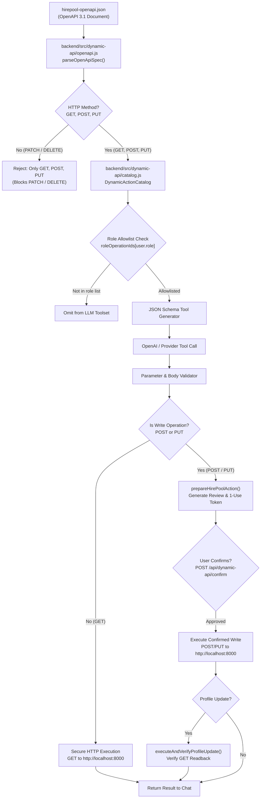

# HirePool Dynamic API Operation Inventory & Parser Specification
**Document Classification:** Technical Architecture & Operation Catalog  
**SDK Repository:** `D:\ai-assistant-plugin`  
**Platform Repository:** `D:\talenthub-develop`  
**Date:** November 9, 2026  

---

## 1. Dynamic API Pipeline Architecture

The Dynamic API system in the AI Assistant SDK automatically converts HirePool's OpenAPI 3.1 specification (`hirepool-openapi.json`) into LLM function tools, enforces role-based access control, intercepts state mutations for confirmation staging, and dispatches authenticated HTTP requests to the FastAPI backend.



---

## 2. OpenAPI Parser Constraints & Rejection Rules

Located in `backend/src/dynamic-api/openapi.js:369-415`:

```javascript
// Rule 1: Operation ID Validation
if (!operationId || !/^[a-zA-Z0-9][a-zA-Z0-9._:-]{0,99}$/.test(operationId)) {
  reject('Operation ID is missing or invalid');
  continue;
}

// Rule 2: Method Allowlist Enforcement
if (!['GET', 'POST', 'PUT'].includes(method)) {
  reject('Only GET, POST, and PUT operations are supported');
  continue;
}
```

### Impact Analysis
1. **Rejection of `PATCH`**:
   - `update_job_status_api_v1_jobs__job_id__status_patch`: Rejected. Prevents dedicated job activation/closure endpoint.
   - `update_application_status_api_v1_applications__application_id__status_patch`: Rejected. Prevents dedicated single-application recruiter notes and status transitions.
2. **Rejection of `DELETE`**:
   - `delete_candidate_api_v1_consultancies_candidates__candidate_id__delete`: Rejected. Prevents candidate removal from agency pool.
   - `withdraw_application_...delete`: Rejected. (Note: Candidate withdrawal succeeds because HirePool backend provides an alternative POST route `POST /api/v1/applications/{application_id}/withdraw`).

---

## 3. Comprehensive Operation Inventory

### 3.1 Candidate Role Allowlist (10 Operations)

| Operation ID | Method & Path | Parameter Schema | Staging Review Handler | Readback Verification | Test Coverage |
|---|---|---|---|---|---|
| `get_my_profile_api_v1_candidates_profile_get` | `GET /api/v1/candidates/profile` | None | Read-only | N/A | Mock Test 21 |
| `update_my_profile_api_v1_candidates_profile_put` | `PUT /api/v1/candidates/profile` | `body: CandidateProfileUpdate` | Preflight profile read + field summary | Reads back profile via `get_my_profile` | Mock Test 22 |
| `search_jobs_api_v1_jobs_search_get` | `GET /api/v1/jobs/search` | `query: { keyword, location, ... }` | Read-only | N/A | Mock Test 24 |
| `get_matching_jobs_api_v1_matching_jobs_get` | `GET /api/v1/matching/jobs` | `query: { page, page_size }` | Read-only | N/A | Mock Test 25 |
| `get_job_api_v1_jobs__job_id__get` | `GET /api/v1/jobs/{job_id}` | `path: { job_id }` | Read-only | N/A | Mock Test 17 |
| `get_screening_questions_for_candidate_...` | `GET /api/v1/jobs/{job_id}/screening-questions/candidate` | `path: { job_id }` | Read-only | N/A | Mock Test 27 |
| `check_screening_eligibility_...` | `GET /api/v1/applications/screening/eligibility/{job_id}` | `path: { job_id }` | Read-only | N/A | Mock Test 28 |
| `get_my_applications_api_v1_applications_my_applications_get` | `GET /api/v1/applications/my-applications` | `query: { page, page_size }` | Read-only | N/A | Mock Test 19 |
| `create_application_api_v1_applications_post` | `POST /api/v1/applications` | `body: ApplicationCreate` | 5 preflight assertions: job active, profile complete, no duplicate, screening check, eligibility check | Verifies `data.id` & `status`, updates session workflow | Mock Test 17 |
| `withdraw_application_..._withdraw_post` | `POST /api/v1/applications/{application_id}/withdraw` | `path: { application_id }, body: { reason }` | History preflight check, verifies ownership & non-withdrawn | Verifies response message | Mock Test 19 |

---

### 3.2 Company / Client Role Allowlist (13 Operations)

| Operation ID | Method & Path | Parameter Schema | Staging Review Handler | Readback Verification | Test Coverage |
|---|---|---|---|---|---|
| `get_my_company_profile_api_v1_clients_profile_get` | `GET /api/v1/clients/profile` | None | Read-only | N/A | Unit Mock |
| `update_company_profile_api_v1_clients_profile_put` | `PUT /api/v1/clients/profile` | `body: ClientProfileUpdate` | Preflight profile read + field summary | Reads back via `get_my_company_profile` | Unit Mock |
| `get_my_user_profile_api_v1_clients_me_get` | `GET /api/v1/clients/me` | None | Read-only | N/A | Unit Mock |
| `update_my_user_profile_api_v1_clients_me_put` | `PUT /api/v1/clients/me` | `body: UserUpdate` | Preflight read + field summary | Reads back via `get_my_user_profile` | Unit Mock |
| `get_dashboard_stats_api_v1_clients_dashboard_get` | `GET /api/v1/clients/dashboard` | None | Read-only | N/A | Unit Mock |
| `get_my_jobs_api_v1_jobs_my_jobs_get` | `GET /api/v1/jobs/my-jobs` | `query: { status, page }` | Read-only | N/A | Unit Mock |
| `create_job_api_v1_jobs_post` | `POST /api/v1/jobs` | `body: JobCreate` | Staged review summary (no preflight check) | None (Returns generic confirmation) | None |
| `update_job_api_v1_jobs__job_id__put` | `PUT /api/v1/jobs/{job_id}` | `path: { job_id }, body: JobUpdate` | Staged review summary (no ownership check) | None (Returns generic confirmation) | None |
| `get_job_api_v1_jobs__job_id__get` | `GET /api/v1/jobs/{job_id}` | `path: { job_id }` | Read-only | N/A | Unit Mock |
| `get_job_applications_api_v1_applications_job__job_id__get` | `GET /api/v1/applications/job/{job_id}` | `path: { job_id }, query: { status }` | Read-only | N/A | Unit Mock |
| `get_client_applications_api_v1_applications_for_client_get` | `GET /api/v1/applications/for-client` | `query: { status, job_id, page }` | Read-only | N/A | Unit Mock |
| `get_matching_candidates_api_v1_matching_candidates__job_id__get` | `GET /api/v1/matching/candidates/{job_id}` | `path: { job_id }` | Read-only | N/A | Unit Mock |
| `bulk_update_status_api_v1_applications_bulk_status_post` | `POST /api/v1/applications/bulk-status` | `body: BulkStatusUpdate` | Staged review summary (no ownership check) | None (Returns generic confirmation) | None |

---

### 3.3 Consultancy / Agency Role Allowlist (13 Operations)

| Operation ID | Method & Path | Parameter Schema | Staging Review Handler | Readback Verification | Test Coverage |
|---|---|---|---|---|---|
| `get_my_consultancy_profile_...` | `GET /api/v1/consultancies/profile` | None | Read-only | N/A | Unit Mock |
| `update_consultancy_profile_...` | `PUT /api/v1/consultancies/profile` | `body: ConsultancyProfileUpdate` | Preflight profile read + field summary | Reads back via `get_my_consultancy_profile` | Unit Mock |
| `get_my_user_profile_api_v1_consultancies_me_get` | `GET /api/v1/consultancies/me` | None | Read-only | N/A | Unit Mock |
| `update_my_user_profile_api_v1_consultancies_me_put` | `PUT /api/v1/consultancies/me` | `body: UserUpdate` | Preflight read + field summary | Reads back via `get_my_user_profile` | Unit Mock |
| `get_dashboard_stats_api_v1_consultancies_dashboard_get` | `GET /api/v1/consultancies/dashboard` | None | Read-only | N/A | Unit Mock |
| `list_candidates_api_v1_consultancies_candidates_get` | `GET /api/v1/consultancies/candidates` | `query: { search, page, page_size }` | Read-only | N/A | Unit Mock |
| `add_candidate_api_v1_consultancies_candidates_post` | `POST /api/v1/consultancies/candidates` | `body: ConsultancyCandidateCreate` | Staged review summary (no duplicate check) | None (Returns generic confirmation) | None |
| `update_candidate_..._put` | `PUT /api/v1/consultancies/candidates/{candidate_id}` | `path: { candidate_id }, body: Update` | Staged review summary (no ownership check) | None (Returns generic confirmation) | None |
| `get_matching_candidates_for_job_...` | `GET /api/v1/consultancies/candidates/matching` | `query: { job_id }` | Read-only | N/A | Unit Mock |
| `get_placements_api_v1_consultancies_placements_get` | `GET /api/v1/consultancies/placements` | `query: { page, page_size }` | Read-only | N/A | Unit Mock |
| `get_placement_stats_api_v1_consultancies_placements_stats_get` | `GET /api/v1/consultancies/placements/stats` | None | Read-only | N/A | Unit Mock |
| `get_consultancy_submissions_...` | `GET /api/v1/applications/for-consultancy` | `query: { job_id, candidate_id, status }` | Read-only | N/A | Unit Mock |
| `bulk_submit_consultancy_candidates_...` | `POST /api/v1/applications/consultancy-submit` | `body: ConsultancyBulkSubmit` | Staged review summary (no ownership or duplicate check) | None (Returns generic confirmation) | None |

---

### 3.4 Missing & Blocked Operations Inventory

The operations below exist in the HirePool FastAPI backend but are currently inaccessible to the AI assistant:

| Operation Description | Backend Route & Function | OpenAPI Operation ID | Status / Reason | Remediation Path |
|---|---|---|---|---|
| **View Candidate Details (Consultancy)** | `GET /api/v1/consultancies/candidates/{candidate_id}` (`consultancies.py:1816`) | `get_candidate_api_v1_consultancies_candidates__candidate_id__get` | **Omitted from `roleOperationIds.consultancy`** | Add operation ID to `roleOperationIds.consultancy` in `local-development.js` |
| **Search Active Jobs (Consultancy)** | `GET /api/v1/jobs/search` (`jobs.py:321`) | `search_jobs_api_v1_jobs_search_get` | **Omitted from `roleOperationIds.consultancy`** | Add operation ID to `roleOperationIds.consultancy` in `local-development.js` |
| **View Applicant Candidate Details (Company)** | `GET /api/v1/clients/candidates/{candidate_id}` (`clients.py:1201`) | `get_candidate_for_client_api_v1_clients_candidates__candidate_id__get` | **Omitted from `roleOperationIds.client`** | Add operation ID to `roleOperationIds.client` in `local-development.js` |
| **Update Job Status Dedicated Endpoint** | `PATCH /api/v1/jobs/{job_id}/status` (`jobs.py:794`) | `update_job_status_api_v1_jobs__job_id__status_patch` | **Rejected by OpenAPI Parser (`PATCH` blocked)** | Update `dynamic-api/openapi.js:377` to allow `PATCH` |
| **Single Application Status & Notes** | `PATCH /api/v1/applications/{application_id}/status` (`applications.py:1410`) | `update_application_status_api_v1_applications__application_id__status_patch` | **Rejected by OpenAPI Parser (`PATCH` blocked)** | Update `dynamic-api/openapi.js:377` to allow `PATCH` |
| **Delete Agency Candidate** | `DELETE /api/v1/consultancies/candidates/{candidate_id}` (`consultancies.py:1880`) | `delete_candidate_api_v1_consultancies_candidates__candidate_id__delete` | **Rejected by OpenAPI Parser (`DELETE` blocked)** | Keep blocked (destructive removal requires explicit policy) or enable with strict staging |
