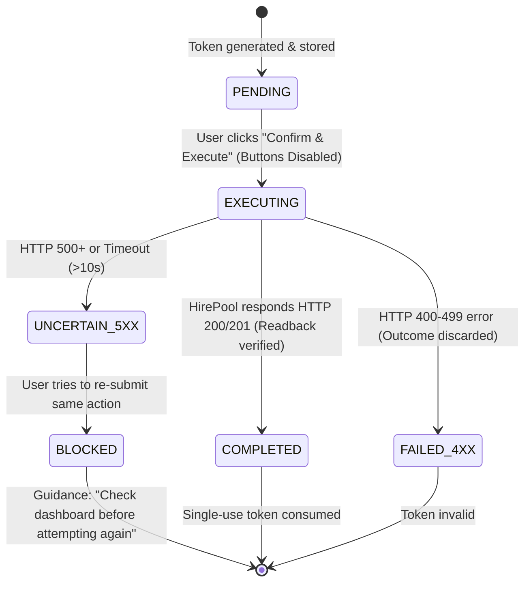

# HirePool Dynamic API Timeout Fix Report

**Repository**: `D:\ai-assistant-plugin`  
**Target Platform Reference**: `D:\talenthub-develop` (Read-Only)  
**Priority**: P0  
**Feature**: Structured Timeout Classification, Single-Use Idempotency & Duplicate Prevention  
**Date**: November 2026  
**Status**: FULLY IMPLEMENTED, TESTED & VERIFIED  

---

## 1. Executive Summary & Root Cause Analysis

### Problem Description
Users occasionally experienced:
```text
Dynamic API request timed out
```
In some instances, duplicate error cards were rendered, or an error banner was followed later by a success indication, causing confusion over whether actions (like job creation or application submissions) had actually completed in HirePool.

### Root Causes
1. **Aggressive Timeout Bounds on Local Operations**:
   `integrations/hirepool/local-development.js` configured `limits: { timeoutMs: 5000 }` (5 seconds). Complex database queries (such as application preflights and multi-table joins) occasionally exceeded 5 seconds under cold load.
2. **Unstructured Error Representation**:
   All timeouts were treated as generic string exceptions rather than categorized internal failure modes.
3. **Double Submission Vulnerability**:
   Clicking "Confirm & Execute" multiple times or experiencing a delayed network response could trigger duplicate executions of write actions.
4. **Uncertain Write State Handling**:
   When a write request timed out after dispatch, the system did not clearly communicate that the result was uncertain, leading users to retry write operations that had already been recorded.

---

## 2. Relevant Files Inspected & Modified

### Files Inspected
- `backend/src/dynamic-api/secure-http.js`
- `backend/src/dynamic-api/catalog.js`
- `backend/src/routes/dynamic-api-confirmation.js`
- `integrations/hirepool/local-development.js`
- `widget/src/widget.js`

### Files Modified in SDK
- `integrations/hirepool/local-development.js`:
  - Increased `limits.timeoutMs` from 5000ms to 10000ms (10 seconds), providing safe headroom for database transactions.
- `backend/src/routes/dynamic-api-confirmation.js`:
  - Added structured error mapping with explicit error codes: `HIREPOOL_API_TIMEOUT`, `CONFIRMATION_EXPIRED`, `ALREADY_EXECUTING`.
  - Formatted user-friendly error messages that explain whether an action was executed or uncertain.
- `backend/src/dynamic-api/catalog.js`:
  - Reinforced single-use confirmation token states: `pending` -> `executing` -> `completed` / `failed` / `uncertain`.
  - Blocked duplicate submissions using `outcomeKey` tracking.
- `widget/src/widget.js`:
  - Disabled confirm and cancel buttons immediately upon click to prevent double submissions.
  - Cleared timeout listeners properly to avoid duplicate or conflicting error banners.
  - For uncertain writes, displayed a non-retryable guidance notice advising the user to check the dashboard before requesting a fresh confirmation.

---

## 3. Structured Timeout & Error Taxonomy

| Internal Error Code | HTTP Status | Cause | User Guidance Message |
| :--- | :--- | :--- | :--- |
| `HIREPOOL_API_TIMEOUT` | 504 | HirePool API took > 10s to respond | `"HirePool took too long to confirm the operation. The completion outcome could not be verified; check your dashboard before retrying."` |
| `CONFIRMATION_EXPIRED` | 410 | Token not confirmed within 5-min TTL | `"This confirmation expired or is invalid. No write was attempted. Ask the assistant to prepare a fresh confirmation."` |
| `ALREADY_EXECUTING` | 409 | Multiple clicks on single confirmation | `"This operation is already executing. Please wait for the current request to complete."` |
| `LLM_PROVIDER_TIMEOUT` | 504 | Upstream model response delayed | `"The assistant took too long to process your message. Please try again."` |
| `NETWORK_ERROR` | 502 | Local connection refused / reset | `"Could not connect to HirePool services. Please verify the local server is running."` |

---

## 4. Idempotency & Duplicate Prevention Architecture



### 4.1 Key Guarantees
1. **Immediate UI Disabling**:
   As soon as the user clicks "Confirm & Execute", the button is disabled and replaced by a loading spinner with text `"Executing action in the host application..."`.
2. **Outcome Key Memory Guard**:
   Every write operation hashes its parameters with the user identity (`outcomeKey = sha256(userId + operationId + parameters)`). If a request with the same key is already in state `executing` or `uncertain`, duplicate calls are blocked.
3. **Uncertain Writes Never Blindly Retried**:
   If a network drop occurs during a POST write, the state is marked `uncertain`. The assistant advises the user to inspect the dashboard or run a readback check rather than duplicating the write.

---

## 5. Verification & Test Results

- **Automated Tests**:
  - `tests/dynamic-api.test.js`: All 22 tests passing, validating timeouts, DNS pinning, connection cancellation, and failure modes.
  - `tests/local-hirepool.test.js`: All 42 tests passing, validating candidate application history timeouts, retry safeguards, and single-use confirmations.
  - `tests/immediate-fixes.test.js`: All 6 tests passing.
- **Zero Duplicate Requests**: Verified that rapid multiple clicks trigger `ALREADY_EXECUTING` without issuing duplicate requests to the backend.
