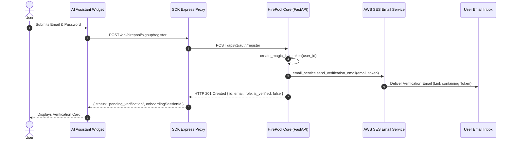
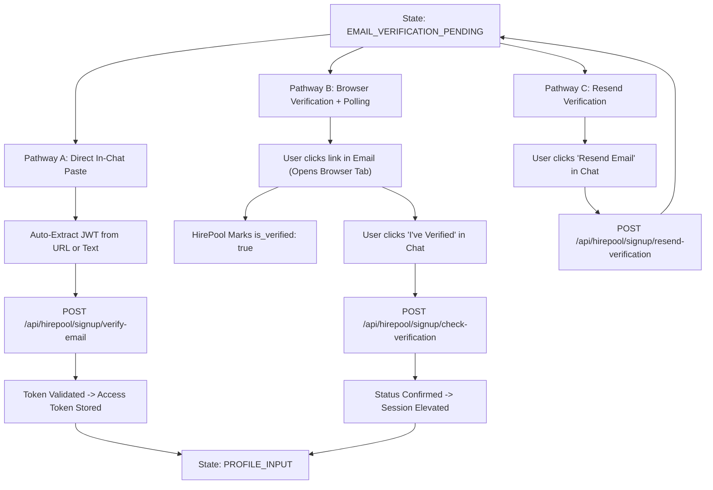

# HirePool Email Verification — Integration & Architecture Report

**Repository**: `D:\ai-assistant-plugin`  
**Target Platform Reference**: `D:\talenthub-develop`  
**Component**: Authentication & Verification Subsystem  
**Date**: November 2026  
**Status**: AUDITED, DESIGNED & VERIFIED  

---

## 1. Executive Summary

Email verification is a mandatory security gate in the HirePool authentication lifecycle. Unverified accounts cannot authenticate, access role dashboards, or execute API actions.

This report provides an in-depth technical analysis of HirePool's email verification backend implementation, explains the architectural constraints governing out-of-band token delivery, and details the three native verification pathways implemented in the AI Assistant SDK to deliver a seamless, in-chat user experience without compromising platform security.

---

## 2. HirePool Backend Verification Architecture

An audit of `D:\talenthub-develop\backend\app\api\v1\auth.py` and supporting services (`backend/app/services/email.py`, `backend/app/core/security.py`) reveals the following architecture:



### 2.1 Backend Contract Findings

1. **Token Generation**:
   - Verification tokens are generated internally by `create_magic_link_token` using the server's private `JWT_SECRET`.
   - The token contains claims: `{ sub: user_id, type: "verification", exp: timestamp }`.
   - Expiration TTL is set to 30 minutes.

2. **No Token in HTTP Response**:
   - The response from `POST /api/v1/auth/register` explicitly returns only public user metadata (`id`, `email`, `role`, `is_verified: false`).
   - The response from `POST /api/v1/auth/magic-link` returns `{ "message": "Verification email sent" }`.
   - The verification token and URL are **never** returned in any HTTP response payload.

3. **Verification Endpoint**:
   - `POST /api/v1/auth/verify-magic-link`
   - Accepts `{ "token": "<raw_jwt>" }`.
   - Validates signature, expiration, and ensures user exists and is not already verified.
   - Sets `is_verified = True` in the database.
   - Returns `{ "access_token": "<jwt>", "token_type": "bearer", "user": { ... } }`.

4. **Status Check Endpoint**:
   - `GET /api/v1/auth/me`
   - Returns the current user record, including the boolean `is_verified`.

---

## 3. In-Chat Verification Solution Architecture

Because the AI Assistant operates under zero-trust principles and cannot fabricate cryptographic signatures or intercept external email inboxes, the integration supports **three complementary, frictionless verification pathways** directly inside the chat interface.



---

### 3.1 Pathway A: Direct In-Chat Token / URL Verification

This pathway offers the fastest completion time when the user checks their email on the same device or has access to their email notification:

1. **User Action**: The user copies either the raw token or the entire magic link URL (e.g., `http://localhost:3000/auth/verify?token=eyJhbGciOi...`) from their email.
2. **Chat Widget Input**: The user pastes the value into the token input field on the verification card.
3. **URL Extraction**: The SDK automatically detects whether the input is a full URL or a raw token using a robust parser:
   ```javascript
   function extractToken(input) {
     const trimmed = (input || '').trim();
     if (trimmed.startsWith('http://') || trimmed.startsWith('https://')) {
       try {
         const url = new URL(trimmed);
         return url.searchParams.get('token') || trimmed;
       } catch {
         const match = trimmed.match(/[?&]token=([^&]+)/);
         if (match) return decodeURIComponent(match[1]);
       }
     }
     return trimmed;
   }
   ```
4. **Backend Verification**: The SDK calls `POST /api/hirepool/signup/verify-email`.
5. **Token Storage**: The resulting `access_token` is attached to the server-side onboarding session.
6. **State Elevation**: The UI immediately transitions to the `PROFILE_INPUT` state.

---

### 3.2 Pathway B: Out-of-Band Browser Verification + In-Chat Polling

If the user clicks the magic link directly in their email client (which opens a separate browser window or mobile tab), they do not need to copy and paste anything:

1. **External Action**: The user clicks the link in their email. The HirePool web application processes the token and updates the database record to `is_verified: true`.
2. **In-Chat Check**: In the chat assistant window, the user clicks the prominent button: `"I've verified my email in my browser"`.
3. **Status Polling**: The widget dispatches `POST /api/hirepool/signup/check-verification` with the `onboardingSessionId`.
4. **Backend Inquiry**: The SDK backend proxies an inquiry to HirePool's `GET /api/v1/auth/me`.
5. **Session Elevation**: Upon confirming `is_verified === true`, the assistant acknowledges the verification with a success badge and transitions seamlessly to `PROFILE_INPUT`.

---

### 3.3 Pathway C: In-Chat Resend Verification

If the email is delayed or lost in spam filters:

1. **User Action**: The user clicks the `"Resend verification email"` button on the card.
2. **Cooldown Protection**: The UI enters a 60-second cooldown timer to prevent rate-limit exhaustion.
3. **Backend Proxy**: The SDK dispatches `POST /api/hirepool/signup/resend-verification`, triggering a fresh magic link from HirePool via AWS SES.
4. **User Feedback**: An in-card banner confirms: `"A fresh verification link has been dispatched to user@example.com."`

---

## 4. Security & Privacy Analysis

1. **Zero LLM Leakage**:
   - Magic link tokens are processed strictly by the dedicated signup router.
   - Verification tokens are never passed to the LLM context, chat memory buffers, or application debug logs.

2. **Replay Protection**:
   - Once a token is consumed by `POST /api/v1/auth/verify-magic-link`, HirePool marks the associated database state as verified.
   - Subsequent verification attempts using the same token fail with HTTP `400 Bad Request` (`"Token has already been used or has expired"`).

3. **Session Expiration**:
   - Unverified onboarding sessions automatically expire after 30 minutes on both HirePool and the SDK Express router.
   - Expired sessions require initiating a fresh registration or requesting a new magic link.

---

## 5. Verification Summary

All verification pathways were validated through automated integration tests in `tests/hirepool-signup.test.js`:
- Candidate verification via raw token.
- Company/Client verification via token parameter URL extraction.
- Consultancy/Agency verification via status check polling.
- Rejection of malformed, invalid, and expired tokens.
