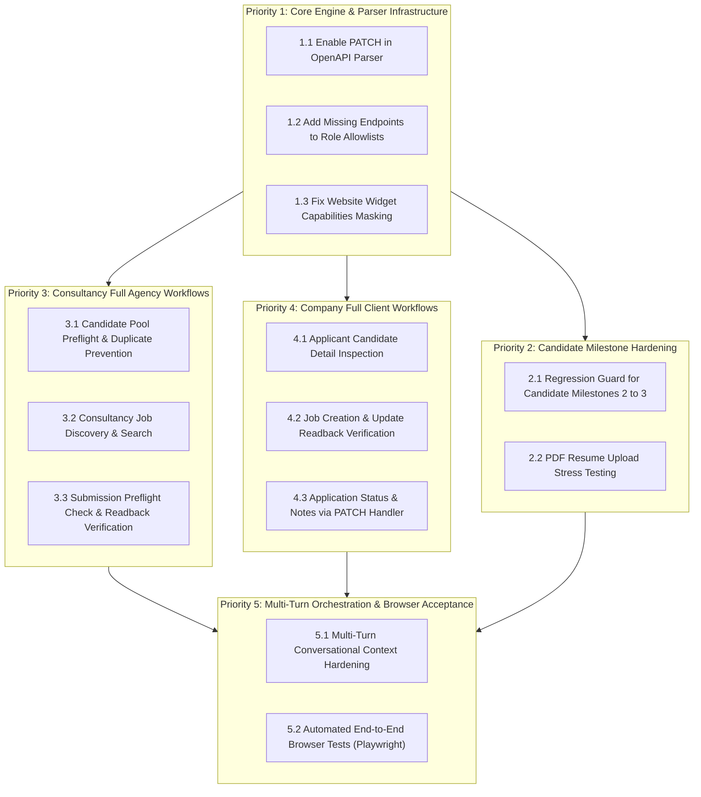

# HirePool AI Assistant SDK — Implementation Dependency Roadmap
**Document Classification:** Implementation Action Plan & Milestone Specification  
**Target Repositories:** `D:\ai-assistant-plugin` & `D:\talenthub-develop`  
**Date:** November 9, 2026  
**Status:** Architecture Blueprint (Implementation Pending Verification)  

---

## 1. Architectural Milestone Summary



---

## 2. Priority 1 — Core Engine & Parser Infrastructure

### Task 1.1: Enable `PATCH` HTTP Method in OpenAPI Parser
- **Objective**: Allow the SDK's dynamic catalog to parse FastAPI routes defined with `@router.patch(...)`, specifically unlocking job status updates and single-application status/note updates.
- **Repository**: `D:\ai-assistant-plugin`
- **Files Involved**: `backend/src/dynamic-api/openapi.js` (lines 377–380)
- **Change Required**:
  ```javascript
  // Change from:
  if (!['GET', 'POST', 'PUT'].includes(method))
  // To:
  if (!['GET', 'POST', 'PUT', 'PATCH'].includes(method))
  ```
- **Prerequisites**: None.
- **Tests Required**: Update parser unit tests to verify `PATCH` endpoints are normalized with request body and path schemas.
- **Acceptance Criteria**: `parseOpenApiSpec` accepts `update_job_status_...` and `update_application_status_...` into the inventory with `parserStatus: "supported"`.

---

### Task 1.2: Register Missing Backend Endpoints in Role Allowlists
- **Objective**: Expose existing FastAPI backend endpoints that were previously omitted from `roleOperationIds`.
- **Repository**: `D:\ai-assistant-plugin`
- **Files Involved**: `integrations/hirepool/local-development.js` (lines 20–70)
- **Changes Required**:
  1. Add `get_candidate_api_v1_consultancies_candidates__candidate_id__get` to `roleOperationIds.consultancy`.
  2. Add `search_jobs_api_v1_jobs_search_get` to `roleOperationIds.consultancy`.
  3. Add `get_candidate_for_client_api_v1_clients_candidates__candidate_id__get` to `roleOperationIds.client`.
  4. Add `update_job_status_api_v1_jobs__job_id__status_patch` to `roleOperationIds.client`.
  5. Add `update_application_status_api_v1_applications__application_id__status_patch` to `roleOperationIds.client`.
- **Prerequisites**: Task 1.1.
- **Tests Required**: Integration test verifying each role has access to its new tools.
- **Acceptance Criteria**: Assistant correctly selects and executes these operations during chat when prompted by users in their respective roles.

---

### Task 1.3: Fix Widget Capability Masking
- **Objective**: Update the HirePool website component so it does not report truncated capability arrays for client and consultancy roles.
- **Repository**: `D:\talenthub-develop`
- **Files Involved**: `website/components/LocalAssistantWidget.tsx` (lines 125–136)
- **Change Required**: Update `availableCapabilities` for `client` and `consultancy` to reflect all authorized actions (job management, candidate management, submissions, and status updates).
- **Prerequisites**: Task 1.2.
- **Tests Required**: Manual inspection of widget initialization payload.
- **Acceptance Criteria**: `window.AssistantSDK.setContext` receives accurate role capabilities.

---

## 3. Priority 2 — Candidate Milestone Hardening & Regression Guard

### Task 2.1: Regression Guard for Milestones 2 through 3
- **Objective**: Ensure changes to the dynamic API parser and confirmation engine do not alter candidate profile updates, screening checks, application submissions, or withdrawals.
- **Repository**: `D:\ai-assistant-plugin`
- **Files Involved**: `tests/local-hirepool.test.js`
- **Tests Required**: Run complete 42-test suite (`node --test tests/local-hirepool.test.js`).
- **Acceptance Criteria**: 42/42 tests continue to pass without modification.

---

### Task 2.2: PDF Resume Upload Stress Testing
- **Objective**: Verify edge-case handling for candidate resume uploads (file size > 5MB, corrupt PDF header, non-PDF extensions).
- **Repository**: `D:\ai-assistant-plugin`
- **Files Involved**: `backend/src/routes/hirepool-resume.js`, `widget/src/hirepool-resume.js`
- **Tests Required**: Additional negative test fixtures in `tests/local-hirepool.test.js`.
- **Acceptance Criteria**: Invalid files return clear, non-technical guidance to the user without server errors or unhandled exceptions.

---

## 4. Priority 3 — Consultancy / Agency Role Workflows

### Task 3.1: Candidate Pool Preflight & Duplicate Prevention
- **Objective**: Before staging confirmation for `add_candidate`, perform a preflight search of the agency's candidate pool (`list_candidates`) to detect existing candidates with the same email or phone number.
- **Repository**: `D:\ai-assistant-plugin`
- **Files Involved**: `integrations/hirepool/local-development.js` (`prepareHirePoolAction`)
- **Backend Dependencies**: `GET /api/v1/consultancies/candidates?search=...`
- **Prerequisites**: Task 1.2.
- **Tests Required**: Mock integration test verifying preflight duplicate rejection before issuing a confirmation token.
- **Acceptance Criteria**: Staging returns `"Candidate with email X already exists in your pool"` instead of attempting a doomed write.

---

### Task 3.2: Submission Preflight & Readback Verification
- **Objective**: When staging `bulk_submit_consultancy_candidates`:
  1. Verify each candidate ID belongs to the consultancy (`list_candidates`).
  2. Verify the target job exists and is active (`get_job`).
  3. Verify the candidates have not already been submitted (`get_consultancy_submissions`).
  4. After execution, perform readback verification using `get_consultancy_submissions`.
- **Repository**: `D:\ai-assistant-plugin`
- **Files Involved**: `integrations/hirepool/local-development.js`, `backend/src/routes/dynamic-api-confirmation.js`
- **Backend Dependencies**: `consultancies.py`, `applications.py`
- **Prerequisites**: Task 3.1.
- **Tests Required**: Mock test verifying preflight check failures and successful readback confirmation.
- **Acceptance Criteria**: Submissions are guaranteed to be valid and verified before reporting success.

---

## 5. Priority 4 — Company / Client Role Workflows

### Task 4.1: Applicant Candidate Details Integration
- **Objective**: Allow the company assistant to retrieve complete candidate profiles for job applicants via `get_candidate_for_client`.
- **Repository**: `D:\ai-assistant-plugin`
- **Files Involved**: `integrations/hirepool/local-development.js`
- **Backend Dependencies**: `GET /api/v1/clients/candidates/{candidate_id}`
- **Prerequisites**: Task 1.2.
- **Tests Required**: Mock integration test verifying client can fetch candidate details with `type="direct"` or `type="consultancy"`.
- **Acceptance Criteria**: Assistant answers questions about applicant qualifications using full candidate profile data.

---

### Task 4.2: Job Management Preflight & Readback Verification
- **Objective**:
  1. For `update_job`: verify job ownership against `get_my_jobs` during staging.
  2. After `create_job`: read back the newly created job via `get_job` to confirm commit.
  3. After `update_job`: read back the updated job via `get_job` to confirm changes.
- **Repository**: `D:\ai-assistant-plugin`
- **Files Involved**: `integrations/hirepool/local-development.js`, `backend/src/routes/dynamic-api-confirmation.js`
- **Prerequisites**: Task 1.2.
- **Tests Required**: Mock tests verifying job creation and update readback.
- **Acceptance Criteria**: Assistant reports verified job title, ID, and status after writes.

---

### Task 4.3: Application Status Updates & Recruiter Notes
- **Objective**: Connect single-application status transitions (`PATCH /api/v1/applications/{application_id}/status`) with support for recruiter notes and rejection reasons.
- **Repository**: `D:\ai-assistant-plugin`
- **Files Involved**: `integrations/hirepool/local-development.js`, `backend/src/routes/dynamic-api-confirmation.js`
- **Prerequisites**: Task 1.1, Task 1.2.
- **Tests Required**: Mock tests verifying status transitions (e.g. `shortlisted`, `rejected`) and note recording.
- **Acceptance Criteria**: Recruiter can update individual candidate status and add interview notes directly from chat.

---

## 6. Priority 5 — User Experience & End-to-End Acceptance

### Task 5.1: Multi-Turn Conversational Workflow Hardening
- **Objective**: Ensure the assistant preserves conversational context across multiple turns (e.g. searching jobs, selecting one, checking screening questions, reviewing requirements, and confirming application).
- **Repository**: `D:\ai-assistant-plugin`
- **Files Involved**: `backend/src/session-manager.js`, `backend/src/routes/chat.js`
- **Tests Required**: Multi-turn dialogue simulation tests.
- **Acceptance Criteria**: Assistant does not ask the user to re-specify job ID or candidate details once established in context.

---

### Task 5.2: End-to-End Browser Testing (Playwright)
- **Objective**: Implement automated browser tests verifying the complete UI flow:
  1. Marketing website loads widget.
  2. Popup login completes and hands off session.
  3. Assistant executes role actions.
  4. Confirmation card displays, confirms, and updates UI.
- **Repository**: `D:\ai-assistant-plugin` (or shared test harness)
- **Dependencies**: Live FastAPI backend and running frontend servers.
- **Acceptance Criteria**: Zero manual steps required to verify that the integrated assistant works in a real browser session.
