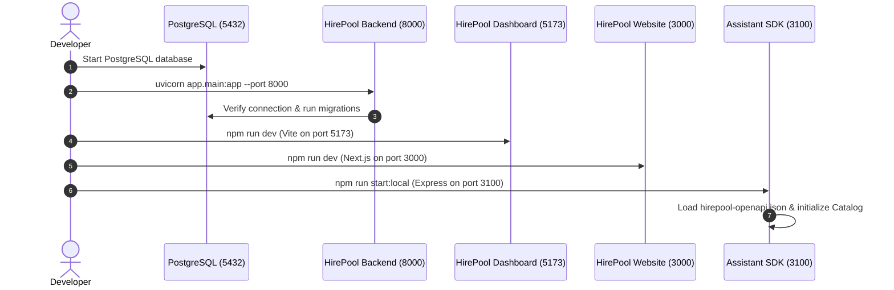
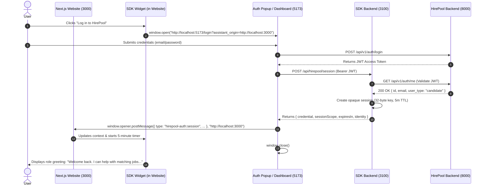
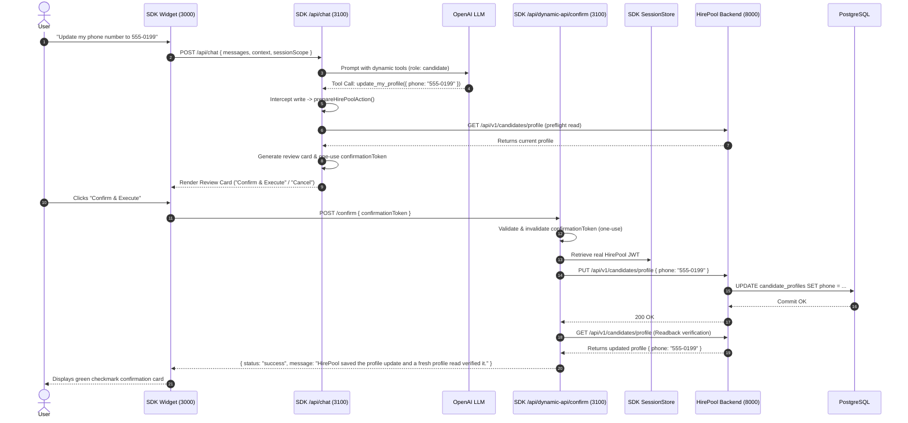

# HirePool & AI Assistant SDK — Repository Architecture Report
**Primary SDK Repository:** `D:\ai-assistant-plugin`  
**Reference Platform Repository:** `D:\talenthub-develop`  
**Date:** November 9, 2026  
**Status:** Strictly Read-Only Architecture Inspection  

---

## 1. Architectural Overview & Design Philosophy

The architecture connecting HirePool and the AI Assistant SDK is based on **strict decoupling**:
- HirePool operates as an independent multi-tenant recruitment SaaS application with FastAPI, PostgreSQL, Next.js, and React.
- The AI Assistant SDK operates as a standalone conversational AI middleware and client widget package.
- The SDK does **not** import HirePool code, models, or database connections.
- Communication between the two systems is governed entirely by standard web standards:
  - **Dynamic Tool Invocation**: Driven by an OpenAPI 3.1 specification parsed at runtime into JSON Schema tools.
  - **Authentication Handoff**: Cross-window postMessage protocol with origin verification and opaque session exchange.
  - **API Execution**: Authenticated HTTP requests dispatched using the user's decrypted JWT bearer token.

---

## 2. Directory Structure Audit

### 2.1 AI Assistant SDK (`D:\ai-assistant-plugin`)

```
D:\ai-assistant-plugin
├── backend/
│   ├── src/
│   │   ├── app.js                              # Express app configuration & middleware pipeline
│   │   ├── server.js                           # HTTP server listener (default port: 3100)
│   │   ├── session-manager.js                  # Conversation session & workflow state persistence
│   │   ├── session-scope.js                    # Session scoping & tenant partitioning helpers
│   │   ├── actions/
│   │   │   ├── registry.js                     # Core ActionRegistry for tool definitions
│   │   │   └── tool-converter.js               # Converter: Action definitions -> LLM tool calls
│   │   ├── dynamic-api/
│   │   │   ├── openapi.js                      # OpenAPI 3.0/3.1 parser, validator & normalizer
│   │   │   ├── catalog.js                      # DynamicActionCatalog: Tool generator & execution engine
│   │   │   └── secure-http.js                  # SSRF-protected HTTP client for external API requests
│   │   ├── local-integrations/
│   │   │   ├── hirepool-auth.js                # Auth bridge: Session exchange, continuation, revocation
│   │   │   ├── hirepool-session-store.js       # In-memory store: Opaque tokens -> Real JWTs (5m TTL)
│   │   │   └── hirepool-continuation-store.js  # Temporary store for cross-login conversation continuity
│   │   ├── middleware/
│   │   │   ├── auth.js                         # Bearer token authentication & role verification
│   │   │   ├── security.js                     # Security headers, CORS configuration, rate limits
│   │   │   ├── logger.js                       # Request/response logging
│   │   │   └── error-handler.js                # Centralized error formatter
│   │   ├── providers/
│   │   │   ├── factory.js                      # LLM Provider factory (OpenAI, Gemini, Groq, Mock)
│   │   │   ├── openai.js                       # OpenAI GPT-4o integration with native tool calling
│   │   │   ├── gemini.js                       # Google Gemini provider implementation
│   │   │   ├── groq.js                         # Groq fast-inference provider
│   │   │   └── mock.js                         # Deterministic mock provider for local testing
│   │   ├── routes/
│   │   │   ├── chat.js                         # Primary conversational endpoint: POST /api/chat
│   │   │   ├── dynamic-api-confirmation.js     # Two-step confirmation: POST /confirm & /cancel
│   │   │   ├── hirepool-resume.js              # Dedicated candidate resume upload pipeline
│   │   │   ├── sessions.js                     # Conversation session lifecycle endpoints
│   │   │   └── health.js                       # Health check endpoint: GET /api/health
│   │   └── services/
│   │       └── document-parser.js              # PDF / document text extractor
├── connectors/
│   ├── base.js                                 # Connector base class
│   ├── bridge.js                               # Connector to ActionRegistry bridge
│   ├── registry.js                             # Multi-connector registration catalog
│   └── mock-connector.js                       # Mock connector implementation
├── integrations/
│   └── hirepool/
│       ├── local-development.js                # Bridge config, role allowlists, preflight staging
│       ├── actions.js                          # Static HirePool actions (legacy)
│       └── dynamic-integration.example.json    # Example configuration schema
├── widget/
│   ├── src/
│   │   ├── widget.js                           # UI component: Chat window, launcher, action cards
│   │   ├── sdk.js                              # Client SDK core: Event bus, host integration bridge
│   │   ├── api-client.js                       # HTTP client communicating with SDK Express backend
│   │   ├── hirepool-login.js                   # Popup window manager for dashboard auth handoff
│   │   ├── hirepool-resume.js                  # Candidate PDF upload UI & upload coordinator
│   │   ├── storage.js                          # LocalStorage conversation persistence
│   │   ├── markdown.js                         # Client-side Markdown & code block parser
│   │   └── styles.css                          # Scoped stylesheet for chat widget
├── config/
│   ├── schemas.js                              # System-wide JSON validation schemas
│   ├── defaults.js                             # Default ports, models, and timeouts
│   └── hirepool-site-policy.js                 # Cross-origin and host security policies
└── tests/
    ├── local-hirepool.test.js                  # 42-test integration suite for HirePool bridge
    └── auth-lifecycle.test.js                  # Authentication lifecycle test suite
```

---

### 2.2 HirePool Platform (`D:\talenthub-develop`)

```
D:\talenthub-develop
├── backend/
│   └── app/
│       ├── main.py                             # FastAPI application entry point, CORS, routers
│       ├── core/
│       │   ├── config.py                       # Environment settings, JWT secrets, database URLs
│       │   └── security.py                     # Password hashing, JWT token creation/decoding
│       ├── db/
│       │   └── session.py                      # SQLAlchemy async engine & session maker
│       ├── models/                             # SQLAlchemy database models
│       │   ├── user.py                         # User, CandidateProfile, ClientProfile, ConsultancyProfile
│       │   ├── job.py                          # Job postings, skills, locations, screening links
│       │   ├── application.py                  # Job applications, statuses, scores, notes
│       │   ├── placement.py                    # Placements, commissions, billing records
│       │   └── screening.py                    # Screening questions, answers, assessments
│       ├── api/
│       │   ├── deps.py                         # FastAPI dependencies (get_current_user, require_*)
│       │   └── v1/
│       │       ├── auth.py                     # Login, token issuance, identity: GET /auth/me
│       │       ├── candidates.py               # Candidate profiles, applications, resume upload
│       │       ├── clients.py                  # Company profiles, jobs, applicant reviews
│       │       ├── consultancies.py            # Agency profiles, candidate pools, submissions
│       │       ├── jobs.py                     # Job search, creation, updates, status toggles
│       │       ├── applications.py             # Application lifecycle, screening, bulk status
│       │       └── matching.py                 # Algorithmic candidate-job matching engine
├── frontend/                                   # Vite + React dashboard (Port 5173)
│   └── src/
│       ├── App.tsx                             # Main dashboard routing & layout
│       ├── contexts/
│       │   └── AuthContext.tsx                 # Auth state, login handler, SDK postMessage bridge
│       └── pages/                              # Role-specific dashboard views
│           ├── CandidateDashboard.tsx          # Candidate home, applications, profile
│           ├── ClientDashboard.tsx             # Company home, jobs, applicant tracking
│           └── ConsultancyDashboard.tsx        # Agency home, candidate pool, submissions
└── website/                                    # Next.js public marketing site (Port 3000)
    ├── app/                                    # Next.js App Router pages
    └── components/
        └── LocalAssistantWidget.tsx            # SDK widget mounting & cross-window auth coordinator
```

---

## 3. Major Module Responsibilities & Entry Points

### 3.1 AI Assistant SDK Backend

#### Entry Point: `backend/src/server.js`
- Loads environment variables (`.env`).
- Starts Express server on `PORT` (default `3100`).
- Initializes session cleanup background timers.

#### App Pipeline: `backend/src/app.js`
- Sets up security middleware (`helmet`, CORS allowlisting).
- Mounts routes:
  - `/api/chat` → Conversational orchestrator with dynamic tool generator.
  - `/api/hirepool` → Local HirePool authentication bridge & session store.
  - `/api/dynamic-api/confirm` → Action confirmation execution & readback.
  - `/api/hirepool/resume` → Staged PDF resume upload endpoints.
  - `/api/health` → Status probe.

#### Dynamic API Engine: `backend/src/dynamic-api/`
- **`openapi.js` (`parseOpenApiSpec`)**:
  - Parses OpenAPI 3.0/3.1 document (`hirepool-openapi.json`).
  - Filters operations: Strictly allows `GET`, `POST`, `PUT` (`lines 377-380`).
  - Normalizes parameters into JSON Schema definitions for OpenAI function calling.
- **`catalog.js` (`DynamicActionCatalog`)**:
  - Encapsulates parsed operations.
  - Generates request-scoped action definitions.
  - Intercepts mutating actions (`POST`/`PUT`) and stages them for confirmation.
  - Dispatches authorized HTTP requests to backend targets via `secure-http.js`.

#### Session & Auth Store: `backend/src/local-integrations/`
- **`hirepool-auth.js`**:
  - `POST /api/hirepool/session`: Receives HirePool JWT, validates against `http://localhost:8000/api/v1/auth/me`, issues opaque credential token.
  - `POST /api/hirepool/session/revoke`: Invalidates session on user signout.
  - `GET /api/hirepool/session/continuation/consume`: Bridges pre-login conversation into post-login session.
- **`hirepool-session-store.js`**:
  - Keeps in-memory map of `credentialToken -> { accessToken, identity, expiresAt }`.
  - Implements strict 300-second (5-minute) TTL.

---

### 3.2 HirePool Host Integration

#### Public Website: `website/components/LocalAssistantWidget.tsx`
- Conditionally mounts only on public marketing pages (`PUBLIC_SITE_PATHS`).
- Dynamically loads `http://localhost:3100/widget/bundle.js`.
- Listens for `window.addEventListener("message", handleAuthMessage)` from origin `http://localhost:5173`.
- Bridges user identity and credential tokens to the SDK via `window.AssistantSDK.setContext(...)`.
- Implements `AssistantHostIntegration.executeAction`:
  - Directly posts `{ confirmationToken }` to `http://localhost:3100/api/dynamic-api/confirm`.
  - Implements `cancelHostAction` posting to `/cancel`.

#### Dashboard Frontend: `frontend/src/contexts/AuthContext.tsx`
- Manages authenticated session in React dashboard (`localhost:5173`).
- On successful login:
  - Detects if opened as a popup (`window.opener`).
  - Calls `exchangeForHirePoolSdkSession()`: Posts JWT to `http://localhost:3100/api/hirepool/session`.
  - Sends `postMessage({ type: 'hirepool-auth:session', credential, ... })` to `window.opener`.

---

## 4. Runtime Startup & Communication Sequences

### 4.1 Local Development Startup Flow



---

### 4.2 Cross-Window Authentication Handoff



---

### 4.3 Two-Step Action Execution & Readback Flow



---

## 5. Security & Isolation Architecture

### 5.1 Token Isolation & Opaque Credentialing
- The user's actual HirePool JWT is **never sent to the client browser widget**.
- The client widget receives only a 43-character base64url random credential string.
- The SDK server maintains an in-memory session map. If a compromised browser script steals the widget credential, the attacker cannot make direct requests to the FastAPI backend or access database resources outside the SDK's constrained endpoint interfaces.
- Sessions automatically expire after 300 seconds (5 minutes).

### 5.2 Single-Use Confirmation Tokens
- Mutation operations generate a 43-character confirmation token.
- Tokens are stored in a pending state mapped to the session scope.
- Upon calling `/confirm`, the token is immediately deleted before the HTTP write is dispatched.
- Even if a confirmation request is intercepted, replayed, or duplicated, subsequent requests fail with `410 Gone` / `CONFIRMATION_INVALID_OR_EXPIRED`.

---

## 6. Build, Testing & Deployment Architecture

### 6.1 SDK Build Pipeline
- The chat widget frontend is bundled using Vite / Rollup:
  - Source: `widget/src/widget.js`, `widget/src/sdk.js`, `widget/src/styles.css`.
  - Target: `public/widget/bundle.js` and `public/widget/bundle.css`.
- The Express backend uses native ECMAScript Modules (`"type": "module"` in `package.json`).

### 6.2 Testing Framework
- Test Runner: Node.js native test runner (`node --test`).
- Mock Interception: In-process HTTP server simulating FastAPI endpoints on ephemeral ports.
- Coverage: 42 automated tests covering auth exchange, token validation, candidate workflows, screening preflights, duplicate prevention, and confirmation expiration.
