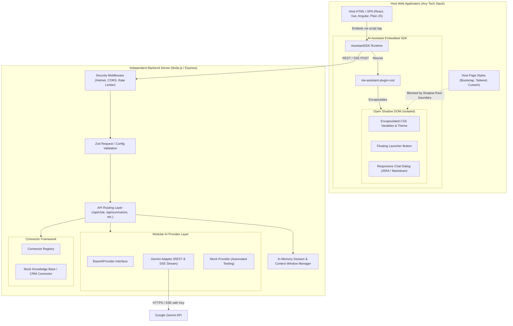

# Architecture Overview

The **Standalone AI Assistant Plugin** is an enterprise-ready, framework-agnostic system designed to run independently and embed into any web application through a single JavaScript `<script>` tag.

## 1. High-Level System Architecture

---

## 2. UI Isolation: Shadow DOM vs. iframe Evaluation

A primary architectural decision was selecting the isolation technique for embedding the widget into third-party host applications.

| Criteria | Shadow DOM (Selected) | iframe Isolation |
| :--- | :--- | :--- |
| **CSS Leakage Prevention** | **Superior**: Host styles (including CSS resets and frameworks like Tailwind or Bootstrap) cannot pierce the Shadow Root boundary. Widget CSS cannot affect the host. | Complete isolation. |
| **Theme & CSS Variable Inheritance** | **Flexible**: Host applications can cleanly customize themes using CSS variables (e.g. `--ai-primary`) or data attributes. | Rigid: Requires postMessage communication or URL query params to pass style configurations. |
| **Accessibility & Screen Readers** | **Seamless**: Widget DOM nodes reside directly in the document accessibility tree. Screen readers natively read ARIA live regions and dialog semantics. | Fragmented: Screen readers struggle with nested iframe boundaries and focus trapping across frame contexts. |
| **Responsive Positioning & Mobile UX** | **Optimal**: Floating launcher and full-height mobile bottom sheet adapt without iframe sizing quirks or window resize listeners. | Cumbersome: Iframes cannot dynamically expand/contract without cross-origin postMessage handshake scripts in the host. |
| **Performance & Footprint** | **Instant**: Single lightweight script bundle (~35KB minified), zero extra HTTP requests or iframe loading overhead. | Heavy: Each iframe instance boots an entirely separate browsing context, DOM window, and script execution engine. |

### Decision Summary
**Shadow DOM (`attachShadow({ mode: 'open' })`) was selected** because it guarantees 100% CSS encapsulation while maintaining first-class accessibility, effortless keyboard focus trapping, dynamic sizing, and zero layout shift.

---

## 3. Modular AI Provider Layer

The AI provider integration is strictly decoupled from the chat widget and API controllers:

1. **`BaseAIProvider` Interface**:
   Defines normalized contracts for `chat()`, `chatStream()`, `summarize()`, and `checkHealth()`.
2. **`GeminiProvider`**:
   Implements direct communication with the Google Gemini API:
   - Request-level timeouts via `AbortSignal`.
   - Exponential backoff retries with jitter for rate limits (HTTP 429) and server overloads (HTTP 503).
   - Server-Sent Events (SSE) stream parsing for token-by-token generation.
   - Intelligent model fallback (e.g., migrating from deprecated model aliases to active models like `gemini-3.5-flash`).
3. **`MockAIProvider`**:
   High-speed, deterministic mock provider for CI/CD pipelines, offline local development, and automated tests.

---

## 4. Conversation & Session Management

To ensure privacy, performance, and predictable token usage, conversation state is managed symmetrically:

- **Server-Side Session Manager**:
  - Keyed by `conversationId` (UUID).
  - Maintains a sliding context window (`MAX_MESSAGES_IN_CONTEXT = 20`) to prevent context overflows and optimize token cost.
  - Automatically sweeps and purges inactive sessions after a configurable TTL (`SESSION_TTL_MS = 2 hours`).
  - Supports `/api/sessions/clear` to instantly flush conversational history.
- **Client-Side Storage**:
  - Uses `sessionStorage` by default.
  - Keeps conversation continuity across page refreshes within the same browser tab.
  - Automatically wipes upon browser tab closure.
  - Falls back gracefully to memory storage if `sessionStorage` is blocked by strict browser privacy settings.

---

## 5. Streaming Transport (Server-Sent Events)

Streaming responses utilize standard Server-Sent Events (SSE) over HTTP `POST /api/chat/stream`:
- Stream packets formatted as standard event chunks: `data: {"type":"chunk","delta":"..."}\n\n`.
- Handles connection cancellation via `req.on('close')`, aborting upstream AI requests immediately to preserve provider quota.
- Includes `X-Accel-Buffering: no` and `Cache-Control: no-cache, no-transform` headers to prevent reverse proxies (e.g. Nginx, Cloudflare) from buffering chunks.

